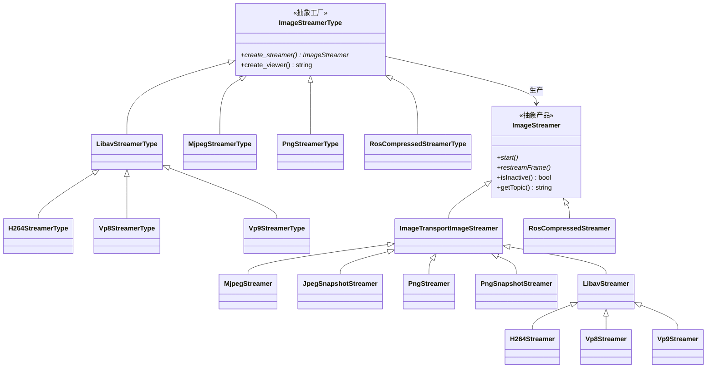
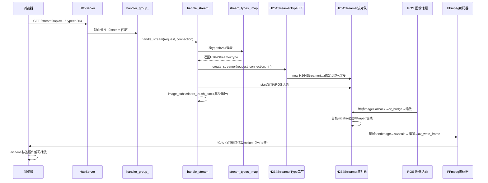

# web_video_server 编码器体系深度剖析：工厂方法模式 × 模板方法模式

## 一、工厂方法和模板方法的总体设计

先从整个编码器体系“为什么长成这样”，再讲清楚“工厂与产品的一对一”关系。

### 1.0 总体设计意图

核心矛盾是：**浏览器请求的编码格式在运行时才知道（`type=mjpeg/png/h264/…`），而每种格式的订阅、编码、推送、HTML 播放标签各不相同**。需要在请求时，根据传入的`type`编码类型创建对应的编码流对象，并且每个编码流对象对应显示的HTML标签也不同。



总体设计用两套正交的模式解耦：

| 维度   | 模式              | 解决的问题                                                   | 对应类                                                       |
| ------ | ----------------- | ------------------------------------------------------------ | ------------------------------------------------------------ |
| 建什么 | 工厂方法模式      | 运行时按 `type` 字符串表示的编码器类型，采用事先准备好的对应`type`类型的具体工厂(`ImageStreamerType`工厂家族)创建对应的具体产品(`ImageStreamer`家族)和相应HTML标签。 | `ImageStreamerType`家族 → `ImageStreamer`家族                |
| 怎么干 | 模板方法模式      | 编码产品通用方法(`ImageStreamer`抽象基类)，根据具体实现路径不同分为：所有编码共用“订阅→解码→缩放→编码→推送”骨架定义`ImageTransportImageStreamer`，只留编码和推送细节在具体类中根据`type`类型不同相应实现，其中`LibavStreamer`进一步定义相同编码路径的不同类型的编码模块(`H.264`、`vp8`、`vp9`)。 | `ImageStreamer`→ `ImageTransportImageStreamer` → `LibavStreamer` +`MjpegStreamer`+... |
| 怎么管 | 注册表 + 多态容器 | 通过顶级抽象工厂`ImageStreamerType`统一表示各个`type`不同的子类具体工厂；<br>通过抽象流对象`ImageStreamer`来统一表示各个`type`不同的子类流对象。 | `std::map<std::string,std::shared_ptr<ImageStreamerType>>`；`std::vector<std::shared_ptr<ImageStreamer>>` |


### 1.1 工厂与产品关系

**抽象工厂根据具体`type`类型创建具体工厂，具体工厂实现抽象工厂定义的抽象方法创建具体产品**。

| 工厂（Type）                                  | 生产的产品（Streamer）                | 关系                                 |
| --------------------------------------------- | ------------------------------------- | ------------------------------------ |
| `MjpegStreamerType`                           | `MjpegStreamer`                       | 一对一                               |
| `PngStreamerType`                             | `PngStreamer`                         | 一对一                               |
| `RosCompressedStreamerType`                   | `RosCompressedStreamer`               | 一对一                               |
| `LibavStreamerType`（参数化基类，不直接注册） | `LibavStreamer`（基类，不直接实例化） | 一对一（基类对基类）                 |
| `H264StreamerType`                            | `H264Streamer`                        | 一对一                               |
| `Vp8StreamerType`                             | `Vp8Streamer`                         | 一对一（源码中直接构造，未走参数化） |
| `Vp9StreamerType`                             | `Vp9Streamer`                         | 一对一                               |

```cpp
// web_video_server.cpp 构造函数中的注册表（招工市场）：
std::map<std::string,std::shared_ptr<ImageStreamerType>> stream_types_;
// key = URL 的 type 参数，value = 对应编码格式的工厂对象
stream_types_["mjpeg"] = boost::shared_ptr<ImageStreamerType>(new MjpegStreamerType());
stream_types_["png"] = boost::shared_ptr<ImageStreamerType>(new PngStreamerType());
stream_types_["ros_compressed"] = boost::shared_ptr<ImageStreamerType>(new RosCompressedStreamerType());
stream_types_["vp8"] = boost::shared_ptr<ImageStreamerType>(new Vp8StreamerType());
stream_types_["h264"] = boost::shared_ptr<ImageStreamerType>(new H264StreamerType());
stream_types_["vp9"] = boost::shared_ptr<ImageStreamerType>(new Vp9StreamerType());
```

---

## 二、工厂方法模式详解

**定义**：定义一个创建对象的抽象工厂类，包括各个类型通用的工厂方法接口，在根据具体类型实例化为具体工厂，并根据类型实现重写相应的工厂方法或实现特有方法。

**为什么本项目必须用工厂方法，而不能在 `handle_stream` 里写一堆 `if-else new`？**原因有三：第一，`type` 是浏览器 URL 在运行时才传进来的，编译期根本不知道要 `new` 谁，必须把“做决策”的逻辑延迟到运行时，而工厂+注册表正是把运行时决策封装起来的标准做法；第二，创建过程不只是 `new`，还包含参数解析（`quality/bitrate/preset/width`）、配套 HTML 标签生成，如果全堆在 `handle_stream` 里，这个函数会膨胀成上百行的上帝函数；第三，视频格式一定会扩展（av1/webp），工厂把“新增”局限为“加两个类+一行注册”，老代码零修改，这正是开闭原则在本项目落地的样子。所以你看到的每个 `*StreamerType` 都很薄——薄恰恰是设计目标，创建的复杂性被分散到各自工厂里，而不是集中爆发。

### 2.1 抽象工厂 `ImageStreamerType`

​	定义各种类型的具体工厂的通用工厂方法接口，包括创建具体类型和相应HTML片段的方法接口。

**为什么抽象工厂恰好是这两个方法、且一个字不多？**`create_streamer` 对应“建流对象”——`handle_stream` 收到请求后唯一需要做的就是拿到一个能 `start()` 的东西；`create_viewer` 对应“建播放标签”——`handle_stream_viewer` 需要一段 HTML 塞进网页。两者是**一次 HTTP 推流请求中“创建侧”仅有的两个变化点**，其余（路由、生命周期、清理）全部不变。所以抽象工厂不存任何数据成员、不做任何默认实现：它只是一纸契约，保证 `WebVideoServer` 手里的 `map<string, shared_ptr<ImageStreamerType>>` 能对 6 种格式一视同仁地调用。返回 `shared_ptr<ImageStreamer>` 而不是裸指针，是因为流对象的生命周期要跨越“请求处理函数返回之后”（持续推流直到浏览器断开），必须用共享所有权交给 `image_subscribers_` 容器托管；用基类指针返回，则调用方全程多态，彻底与具体编码解耦。

```cpp
// image_streamer.h —— 抽象工厂：只声明两种能力，不含任何数据成员
class ImageStreamerType
{
public:
  // 工厂方法 1：按本次请求生产流对象
  // request：含 topic/quality/width/bitrate 等 URL 参数；connection：本次 HTTP 连接；nh：ROS 节点
  // 返回基类智能指针，实现多态；=0 表示纯虚，子类必须实现
  virtual boost::shared_ptr<ImageStreamer> create_streamer(
      const async_web_server_cpp::HttpRequest &request,
      async_web_server_cpp::HttpConnectionPtr connection,
      rclcpp::Node::SharedPtr nh) = 0;

  // 工厂方法 2：生成浏览器播放该格式的 HTML 片段
  // MJPEG/PNG/RosCompressed 返回 ，Libav 系返回 <video>，保证流与标签配套
  virtual std::string create_viewer(
      const async_web_server_cpp::HttpRequest &request) = 0;
};
```

### 2.2 具体工厂

​	根据不同类型创建相应的具体类型工厂，并重写特定具体类型的抽象工厂方法。这里包括根据类型创建对应类型的流对象和显示的HTML显示标签。

**为什么要按“压缩图像类型 vs 编码视频流类型”分组？**因为两组在“产品要不要经过 FFmpeg 管线”上存在本质分野：前者（Mjpeg/Png/RosCompressed）走 OpenCV 逐帧图片编码或直接转发，浏览器用 `` 轮播即可；后者（H264/VP8/VP9）走 FFmpeg 帧间视频编码，浏览器必须用 `<video>` 调硬件解码器。分组后，`create_viewer` 的标签选择、产品的基类选择（是否继承 `ImageTransportImageStreamer`）、CPU/带宽特性都自然归位，读者一眼就能看出两大家族的分界线。

#### 2.2.1 压缩图像类型

**为什么这三个被归为“压缩图像类型”？**它们的共同点是**产品处理的是离散图片帧**：Mjpeg/Png 订阅原始图后每帧独立 `cv::imencode`（帧与帧之间无依赖），RosCompressed 更进一步连编码都省了直接转发。对应地，它们的工厂也最简单——无数据成员，`create_streamer` 就是一行 `new`，`create_viewer` 统一返回 ``。把三者放一起，是为了与 2.2.2 的“视频流类型”（帧间预测、FFmpeg 管线、`<video>` 标签）形成对照。

1. **`MjpegStreamerType`**

**为什么它的两个方法都如此简短？**因为 Mjpeg 把全部复杂性下沉到了产品（`MjpegStreamer` 构造解析 `quality`、发 multipart 头，`sendImage` 做 `imencode`），工厂只负责“选对产品 + 透传参数”。`create_viewer` 里把 `request.query` 原样拼回，是为了让 `` 发起的二次请求携带与首页完全相同的参数（`topic/type/quality`），避免参数丢失导致二次请求行为不一致——这是“配套生产”最精髓的一行代码。

```cpp
// jpeg_streamers.h —— MJPEG 具体工厂：无数据成员，行为固定
class MjpegStreamerType : public ImageStreamerType
{
public:
  // 生产 MjpegStreamer：把 request/connection/nh 透传给产品构造，产品内解析 quality
  boost::shared_ptr<ImageStreamer> create_streamer(
      const async_web_server_cpp::HttpRequest &request,
      async_web_server_cpp::HttpConnectionPtr connection,
      rclcpp::Node::SharedPtr nh)
  {
  	  // 只 new 自己的产品；返回类型上转为基类 ImageStreamer，实现多态
  	  return boost::shared_ptr<ImageStreamer>(new MjpegStreamer(request, connection, nh));
  }
  // 生成  播放标签：MJPEG 是连续 JPEG 图，浏览器图片标签即可轮播
  std::string create_viewer(const async_web_server_cpp::HttpRequest &request)
  {
      std::stringstream ss;
      ss << "</img>";
      return ss.str();
  }
};
```

2. **`PngStreamerType`**

**为什么 Png 工厂与 Mjpeg 工厂几乎逐行相同？**这恰恰证明了工厂方法的价值：当两个格式的“创建逻辑”相同、仅产品类型不同时，代码重复是**有意为之的隔离**——将来 PNG 要加特有参数（比如 `compression_level` 默认值调整、无损截图开关），修改只会影响 `PngStreamerType`，不会误伤 Mjpeg。如果为了消灭这十几行重复而合并工厂，反而会引入 `if (type == ...)` 分支，破坏开闭原则。所以这里的“重复”是设计上可接受的、为扩展性付出的微小代价。

```cpp
// png_streamers.h —— PNG 具体工厂：结构与 Mjpeg 完全同构，只差产品类型
class PngStreamerType : public ImageStreamerType
{
public:
  boost::shared_ptr<ImageStreamer> create_streamer(
      const async_web_server_cpp::HttpRequest &request,
      async_web_server_cpp::HttpConnectionPtr connection,
      rclcpp::Node::SharedPtr nh)
  {
      return boost::shared_ptr<ImageStreamer>(new PngStreamer(request, connection, nh));
  }
  std::string create_viewer(const async_web_server_cpp::HttpRequest &request)
  {
      std::stringstream ss;
  	ss << " 轮播
  	ss << request.query;
  	ss << "\"></img>";
  	return ss.str();
  }
};
```

3. **`RosCompressedStreamerType`**

**为什么转发路线也需要一个工厂，而不是在 `handle_stream` 里特判？**因为 `handle_stream` 的契约是“只认 `ImageStreamerType` 抽象”——如果为转发单独写 `if (type == "ros_compressed") new RosCompressedStreamer`，就等于在调用方打开了类型开关，每加一种直通路线都要改 `handle_stream`。给它一个与其它格式平级的工厂，调用方代码保持“查表→多态创建”不变，这正是工厂方法消除 `if-else` 类型判断的经典收益。注意它的 `create_viewer` 同样返回 ``：虽然服务端零编码，但浏览器收到的依然是连续 JPEG 字节，播放方式与 Mjpeg 无异——工厂保证了“流与标签配套”，调用方无需关心服务端内部是转码还是转发。

```cpp
// ros_compressed_streamer.h —— 转发路线工厂：产品不解码不编码
class RosCompressedStreamerType : public ImageStreamerType
{
public:
  boost::shared_ptr<ImageStreamer> create_streamer(
      const async_web_server_cpp::HttpRequest &request,
      async_web_server_cpp::HttpConnectionPtr connection,
      rclcpp::Node::SharedPtr nh)
  {
  	// 产品订阅 <topic>/compressed 的 CompressedImage，原字节转发，CPU 最省
  	return boost::shared_ptr<ImageStreamer>(new RosCompressedStreamer(request, connection, nh));
  }
  std::string create_viewer(const async_web_server_cpp::HttpRequest &request)
  {
    std::stringstream ss;
  	ss << "
  	ss << request.query;
  	ss << "\"></img>";
  	return ss.str();
  }
};
```

#### 2.2.2 编码视频流类型

**为什么 Libav 系要单独再抽象一层参数化工厂基类？**H264/VP8/VP9 的 `create_streamer` 本体都是“一行 `new`”，真正的差异只有三个字符串（容器/编码器/MIME）。如果让三者直接继承 `ImageStreamerType`，`create_viewer` 的 `<video>` 生成逻辑要重复三遍；而有了 `LibavStreamerType` 这一中间层：配方收敛为三个 `const string` 成员、`create_viewer` 只写一次、子类构造只需填配方。这就是“用数据代替子类”的参数化工厂技巧——当子类的行为差异可以被几个数据值完全刻画时，用成员数据承载差异，而不是用更多的类承载差异。

`LibavStreamerType`

```cpp
// libav_streamer.h —— 参数化工厂基类：把三编码差异收敛为三个字符串
class LibavStreamerType : public ImageStreamerType
{
public:
  // 构造即定配方：容器名 + 编码器名 + MIME；子类构造时各填一组
  LibavStreamerType(const std::string &format_name,   // 如 mp4 / webm
                    const std::string &codec_name,    // 如 libx264 / libvpx / libvpx-vp9
                    const std::string &content_type); // 如 video/mp4 / video/webm
  boost::shared_ptr<ImageStreamer> create_streamer(
      const async_web_server_cpp::HttpRequest &request,
      async_web_server_cpp::HttpConnectionPtr connection,
      rclcpp::Node::SharedPtr nh
  ): format_name_(format_name), codec_name_(codec_name), content_type_(content_type)
  {
  	  // 只保存配方，不建管线；管线在产品首帧 initialize() 里建
  }
  std::string create_viewer(const async_web_server_cpp::HttpRequest &request)
  {
      // 视频流必须用 <video>（浏览器调硬件解码器），不能用 
      std::stringstream ss;
      ss << "<video src=\"/stream?";
      ss << request.query;
      ss << "\" autoplay=\"true\" preload=\"none\"></video>";
      return ss.str();
 }
private:
  const std::string format_name_;   // 容器：mp4 / webm
  const std::string codec_name_;    // 编码器：libx264 / libvpx / libvpx-vp9
  const std::string content_type_;  // MIME：video/mp4 / video/webm
};
```

1. `H264StreamerType`

**为什么 H264 工厂的构造函数只有一行初始化列表？**因为它的全部“知识”就是配方 `("mp4", "libx264", "video/mp4")`——容器决定 `av_guess_format` 和 `movflags` 分片逻辑，编码器名决定 `avcodec_find_encoder_by_name` 找到 x264，MIME 决定 HTTP 响应头和 `<video>` 标签行为。把配方写在构造初始化列表而非 `create_streamer` 函数体里，是 C++ 对 `const` 成员的强制要求，也顺带表达了“配方不可变”的语义。而 `create_streamer` 仍然要重写（不能复用基类的），是因为产品类型不同（`H264Streamer` 含 `preset_` 解析与 `zerolatency` 调优），基类工厂的 `new LibavStreamer` 无法替代。

```cpp
// h264_streamer.h —— H264 具体工厂：继承参数化基类，配方写死
class H264StreamerType : public LibavStreamerType
{
public:
  H264StreamerType() : LibavStreamerType("mp4", "libx264", "video/mp4")  // 容器 mp4，编码 libx264
    {}  // 构造即定配方 mp4 + libx264 + video/mp4
  virtual boost::shared_ptr<ImageStreamer> create_streamer(
      const async_web_server_cpp::HttpRequest& request,
      async_web_server_cpp::HttpConnectionPtr connection,
      rclcpp::Node::SharedPtr nh)
   {
  	// 生产带 zerolatency 调优的 H264 产品（preset/tune/crf 在产品内解析）
  	return boost::shared_ptr<ImageStreamer>(new H264Streamer(request, connection, nh));
   }
};
```

2. **`Vp8StreamerType`**

**为什么 VP8 的配方是 `webm + libvpx`？**WebM 是 Google 主导的开源免专利容器，与 VP8/VP9 天然配套；`libvpx` 是 VP8 的 FFmpeg 编码器名。工厂把这组对应关系固化下来，调用方传 `type=vp8` 就能得到“容器+编码+MIME”三位一体的正确组合，避免在 `handle_stream` 里散落 `if (type == "vp8") format = "webm"` 之类的映射代码。注意该工厂类内对产品 `quality_`（默认 `realtime`）只字不提——质量参数的解析是产品的职责，工厂只管“选对产品”，这就是创建与配置的职责边界。

```cpp
// vp8_streamer.h —— VP8 具体工厂：配方 webm + libvpx + video/webm
class Vp8StreamerType : public LibavStreamerType
{
public:
  Vp8StreamerType() : LibavStreamerType("webm", "libvpx", "video/webm")  // 容器 webm，开源免专利
	{}
  virtual boost::shared_ptr<ImageStreamer> create_streamer(
      const async_web_server_cpp::HttpRequest& request,
      async_web_server_cpp::HttpConnectionPtr connection,
      rclcpp::Node::SharedPtr nh)
  {
  	return boost::shared_ptr<ImageStreamer>(new Vp8Streamer(request, connection, nh));
  }
private:
  // Vp8 产品另有 quality_ 成员（默认 realtime），在产品构造内解析
};
```

3. **`Vp9StreamerType`**

**为什么 VP9 工厂与 VP8 工厂几乎一样，却不能合并？**表面看两者只差编码器名字（`libvpx` vs `libvpx-vp9`），但它们生产的产品行为差异很大：VP9 产品内是 `pass=1/speed=8/cpu-used=4` 的单遍高速策略，而 VP8 是 `deadline=1/drop_frame` 的实时丢帧策略。如果合并成一个“WebM 工厂”再用 `if` 区分产品，就回到了工厂方法要消灭的分支逻辑。保留两个薄工厂，每个只 `new` 自己的产品，是用“多一个类”的代价换取“零分支”的清晰度，完全符合工厂方法的设计初衷。

```cpp
// vp9_streamer.h —— VP9 具体工厂：配方 webm + libvpx-vp9 + video/webm
class Vp9StreamerType : public LibavStreamerType
{
public:
  Vp9StreamerType() : LibavStreamerType("webm", "libvpx-vp9", "video/webm")
  {}
  virtual boost::shared_ptr<ImageStreamer> create_streamer(
      const async_web_server_cpp::HttpRequest& request,
      async_web_server_cpp::HttpConnectionPtr connection,
      rclcpp::Node::SharedPtr nh)
  {
  	// 产品内 speed=8/cpu-used=4/crf=20 单遍高速，注释明示用画质换速度
  	return boost::shared_ptr<ImageStreamer>(new Vp9Streamer(request, connection, nh));
  }
};
```

---

## 三、模板方法模式详解

**定义**：在顶级抽象基类中定义各个不同类型算法的骨架（通用步骤顺序）并实现通用的方法，根据具体类型差异化的方法定义为接口。由具体类型的子类根据相应类型重写实现。**基类掌控流程和通用实现，子类填充差异化细节**。

**为什么本项目必须用模板方法，而不是让每个流各自写订阅编码全流程？**因为 7 种编码（Mjpeg/Png/快照×2/RosCompressed/H264/VP8/VP9）在“订阅话题、转 Mat、缩放翻转、加锁、异常处理、时间戳更新”上完全相同，真正的差异只有两处：首帧要不要建 FFmpeg 管线（`initialize`）、每帧怎么编码推送（`sendImage`）。如果每个子类各写一遍公共流程，不仅重复，更危险的是将来修一个并发 bug（比如 `send_mutex_` 漏加锁）要改 7 处，极易遗漏。模板方法把公共流程写死在基类、差异点留白，子类不可能忘记加锁、忘记更新时间戳、忘记异常转失效——正确性由骨架保证，而不是靠每个开发者的自觉。

### 3.1 抽象模板

​	定义各个类型流对象的通用骨架接口与公共流程实现，包括流生命周期管理与订阅解码缩放等通用步骤。本项目有两层抽象模板：顶层 `ImageStreamer`（生命周期契约）与中间层 `ImageTransportImageStreamer`（OpenCV 路线完整骨架），以及 FFmpeg 路线的第二层骨架 `LibavStreamer`。

#### 3.1.1 顶层抽象模板 `ImageStreamer`

​	所有流对象的根基类，也是 `WebVideoServer::image_subscribers_` 容器持有的统一类型。它的存在价值是让管理器“只认契约、不认具体编码”。

```cpp
// image_streamer.h —— 顶层抽象：生命周期契约 + 共享状态
class ImageStreamer
{
public:
  ImageStreamer(request, connection, nh);  // 保存请求、连接、节点，解析 topic_
  virtual void start() = 0;                // 启动订阅（纯虚：RosCompressed 与中间基类各自实现）
  virtual ~ImageStreamer();
  bool isInactive() { return inactive_; }  // 清理器据此判断是否回收（非虚通用实现）
  virtual void restreamFrame(double max_age) = 0;  // 限速重推（纯虚：各路线各自实现）
  std::string getTopic() { return topic_; }        // 日志与调试用（非虚通用实现）
protected:
  connection_, request_, nh_;  // 本次请求三要素
  bool inactive_;              // 失效标记：浏览器断开或异常时置 true
  image_transport::Subscriber image_sub_;  // 订阅者句柄（RosCompressed 系用自己的成员隐藏它）
  std::string topic_;          // 要订阅的话题名（从 URL 解析）
};
```

**为什么 `start/restreamFrame` 是纯虚，而 `isInactive/getTopic` 是普通函数？**纯虚的是“各路线行为必然不同”的点（OpenCV 路线订阅 `Image`、转发路线订阅 `CompressedImage`、重推逻辑也不同）；普通函数的是“所有路线语义相同”的点（失效标记读写、话题名返回），写在基类避免重复。这正是模板方法“通用写死、差异留白”在最顶层的体现。

#### 3.1.2 中间抽象模板 `ImageTransportImageStreamer`

​	OpenCV 路线（Mjpeg/Png/快照×2/Libav 系）的完整骨架载体，也是本项目模板方法的主战场。

   **在本项目中的映射**：`ImageTransportImageStreamer` 是模板方法的载体：

   ```
   订阅话题 → imageCallback(收到Image) → cv_bridge转Mat → 缩放/翻转
       → initialize(首帧建管线) → sendImage(子类各显神通) → 更新last_frame
   ```

   基类把"订阅、解码、缩放、加锁、异常处理、时间戳"全部写死，**唯一留白的就是 `sendImage()` 和 `initialize()` 两个虚函数**：

   ```cpp
   // image_streamer.h —— 中间基类：骨架已定，细节留白
   class ImageTransportImageStreamer : public ImageStreamer
   {
   public:
     virtual void start();   // 骨架：订阅话题（子类一般不重写）
   protected:
     virtual void sendImage(const cv::Mat &, const rclcpp::Time &time) = 0; // ★ 留白1：怎么编码发送
     virtual void restreamFrame(double max_age);  // 骨架：限速重推（通用实现）
     virtual void initialize(const cv::Mat &);    // ★ 留白2：首帧初始化（默认空实现）
   private:
     void imageCallback(const sensor_msgs::msg::Image::ConstSharedPtr &msg); // 骨架核心：不可重写
   };
   ```

   ```cpp
   // image_streamer.cpp —— 模板骨架：所有 OpenCV 路线编码共用这一套流程
   void ImageTransportImageStreamer::imageCallback(
       const sensor_msgs::msg::Image::ConstSharedPtr &msg)
   {
     if (inactive_)
       return;   // 已失效（浏览器断开）则直接丢弃
   
     cv::Mat img;
     try
     {
       // ---- 步骤 1：ROS Image → OpenCV Mat（按编码分类处理） ----
       if (msg->encoding.find("F") != std::string::npos)
       {
         // 浮点图（如 32FC1 深度）：归一化到 0~255
         cv::Mat float_image_bridge = cv_bridge::toCvCopy(msg, msg->encoding)->image;
         cv::Mat_<float> float_image = float_image_bridge;
         double max_val;
         cv::minMaxIdx(float_image, 0, &max_val);
         if (max_val > 0) { float_image *= (255 / max_val); }
         img = float_image;
       }
       else if(msg->encoding.find("16") != std::string::npos){
         // 16 位图（如 16UC1）：保持原样
         img = cv_bridge::toCvCopy(msg, "16UC1")->image;
       }
       else{
         // 普通彩色图：统一转 BGR
         img = cv_bridge::toCvCopy(msg, "bgr8")->image;
       }
   
       // ---- 步骤 2：可选缩放 / 翻转（URL 参数 width/height/invert） ----
       int input_width = img.cols;
       int input_height = img.rows;
       if (output_width_ == -1)  output_width_ = input_width;   // 没指定则保持原尺寸
       if (output_height_ == -1) output_height_ = input_height;
       if (invert_) { cv::flip(img, img, false); cv::flip(img, img, true); } // 旋转180度
   
       // ---- 步骤 3：加锁，生成输出尺寸图像 ----
       boost::mutex::scoped_lock lock(send_mutex_); // 保护 output_size_image
       if (output_width_ != input_width || output_height_ != input_height)
       {
         cv::Mat img_resized;
         cv::resize(img, img_resized, cv::Size(output_width_, output_height_));
         output_size_image = img_resized;
       }
       else { output_size_image = img; }
   
       // ---- 步骤 4：首帧初始化钩子（Libav 在此建 FFmpeg 管线） ----
       if (!initialized_)
       {
         initialize(output_size_image);  // ★ 虚函数：Mjpeg/Png 默认空实现，Libav 重写
         initialized_ = true;
       }
   
       // ---- 步骤 5：调用子类编码发送（模板方法留白点） ----
       last_frame = nh_->now();
       sendImage(output_size_image, last_frame );  // ★ 纯虚函数：各子类实现
   
     }
     catch (...) { inactive_ = true; return; }  // 任何异常 → 标记失效，等待清理
   }
   ```

#### 3.1.3 第二层抽象模板 `LibavStreamer`（FFmpeg 路线骨架）

​	FFmpeg 路线（H264/VP8/VP9）的第二层骨架。它继承中间层骨架，因此 `start/imageCallback` 全复用；它自己再定义一套“建管线→逐帧编码”的子骨架，把“编码器私有参数”留白给三个子类。

```cpp
// libav_streamer.h —— 第二层骨架：管线生命周期管理
class LibavStreamer : public ImageTransportImageStreamer
{
public:
  LibavStreamer(request, connection, nh, format_name, codec_name, content_type);
  ~LibavStreamer();  // 释放 codec/frame/io_buffer/format_context/sws_context
protected:
  virtual void initializeEncoder();                       // ★ 留白：H264/VP8/VP9 各填私有参数
  virtual void sendImage(const cv::Mat&, const rclcpp::Time& time);  // 重写：swscale→编码→av_write_frame
  virtual void initialize(const cv::Mat&);                // 重写：建 FFmpeg 管线（7 步）
  // FFmpeg 管线成员：format/codec/stream/frame/sws/io_buffer/opt/bitrate/qmin/qmax/gop…
};
```

**为什么需要第二层骨架，而不是让 H264/VP8/VP9 直接继承中间层？**因为三者的 `initialize`（找编码器、建流、填宽高码率、开编码器、分配帧、写容器头）与 `sendImage`（包 AVFrame、swscale 转 YUV、send/receive 包、打 pts、写帧）逐行相同，唯一差异是 `initializeEncoder()` 里的几行 `av_opt_set`。没有这一层，三份 FFmpeg 管线代码要重复三遍，且 FFmpeg 版本兼容宏（`LIBAVCODEC_VERSION_INT` 分支）极易改漏一处。第二层骨架把“FFmpeg 怎么用”收敛到一处，子类只回答“编码器参数是什么”。

### 3.2 具体模板

​	根据继承的骨架不同，具体模板分为两支：直接继承顶层 `ImageStreamer` 的 `RosCompressedStreamer`（自建小骨架），与继承中间骨架的 OpenCV 家族（Mjpeg/Png/快照×2/Libav 系）。划分依据是数据源与流程是否真正相同。

`RosCompressedStreamer` **直接继承 `ImageStreamer`**，而不继承 `ImageTransportImageStreamer`：

| 维度   | 中间基类路线                   | RosCompressed 路线                      |
| ------ | ------------------------------ | --------------------------------------- |
| 数据源 | `sensor_msgs/Image`（原始图）  | `sensor_msgs/CompressedImage`（已压缩） |
| 解码   | `cv_bridge` → Mat              | 不解码                                  |
| 编码   | `cv::imencode` / FFmpeg 重编码 | **零编码，直接转发字节**                |
| 基类   | `ImageTransportImageStreamer`  | `ImageStreamer`                         |

因为数据源类型和处理流程完全不同，硬塞进模板骨架反而破坏内聚。**模板方法只复用"真相同"的流程，不强求"看起来像"的流程**——这是正确使用该模式的关键判断。

#### 3.2.1 `ImageStreamer` 的直接子类 `RosCompressedStreamer`

​	唯一跳过中间骨架的产品。**为什么它必须自建小骨架？**它的输入是 `CompressedImage`（已压缩字节），根本没有 `cv::Mat` 中间形态，中间层的“解码→缩放→`sendImage(Mat)`”骨架对其完全不适用——缩放需要解码后的像素，转发路线恰恰要避免解码。所以它直接继承顶层，自己实现一套极简骨架：`start` 订阅压缩话题 → `imageCallback` 缓存 `last_msg/last_frame` → `sendImage(CompressedImage)` 按 `format` 判 MIME 后原字节转发。它的 `sendImage` 签名都与中间层不同（参数是 `CompressedImage` 而非 `Mat`），这从类型系统层面证明了它不属于同一模板家族。

#### 3.2.2 `ImageTransportImageStreamer` 的子类：OpenCV 图片家族

​	本节覆盖 `MjpegStreamer`、`JpegSnapshotStreamer`、`PngStreamer`、`PngSnapshotStreamer` 四个直接子类。**为什么四者共用同一骨架却行为不同？**因为骨架只固定“输入是什么、怎么预处理”，而“输出是持续流还是单帧、编码是 JPEG 还是 PNG”正是留白点 `sendImage` 要回答的。Mjpeg 与 Png 的 `sendImage` 都是“`imencode` + `sendPartAndClear`”，差异仅在后缀与质量参数语义；两个 Snapshot 的 `sendImage` 都是“`imencode` + 标准单响应 + `inactive_=true`”，差异仅在 MIME。四个子类各用十几行填空，共用上百行骨架，复用比极高。详细实现见第五章 5.1~5.3（每类附完整注释代码）。

#### 3.2.3 `LibavStreamer` 的子类：H264/VP8/VP9

​	本节覆盖 `H264Streamer`、`Vp8Streamer`、`Vp9Streamer` 三个第二层子类。**为什么三者只重写 `initializeEncoder()` 就够了？**因为从“订阅到 Mat”走第一层骨架，从“建管线到逐帧编码推送”走第二层骨架，两层骨架已经覆盖了除编码器私有参数之外的全部流程。H264 填 `preset/tune=zerolatency/crf`（零延迟直播），VP8 填 `deadline/drop_frame`（实时丢帧保流畅），VP9 填 `pass/speed/cpu-used`（单遍高速），三者各 5~10 行，管线代码零重复。详细实现见第五章 5.6~5.8（每类附完整注释代码与参数语义解读）。

### 5.1 MjpegStreamer（最常用：连续 JPEG 视频流）

**定位**：订阅原始图，自己用 OpenCV 编 JPEG，走 multipart 持续推送。浏览器用 `` 轮播。

```cpp
// jpeg_streamers.cpp
MjpegStreamer::MjpegStreamer(
    const async_web_server_cpp::HttpRequest &request,
    async_web_server_cpp::HttpConnectionPtr connection,
    rclcpp::Node::SharedPtr nh) :
  // 1. 调基类构造（解析 topic/width/height/invert 等通用参数）
  ImageTransportImageStreamer(request, connection, nh),
  // 2. 构造 multipart 推流器（绑定取时间的函数 + 连接）
  stream_(std::bind(&rclcpp::Node::now, nh), connection)
{
  // 3. 读本格式私有参数：JPEG 质量（默认 95，越高越清晰越大）
  quality_ = request.get_query_param_value_or_default<int>("quality", 95);
  // 4. 先发 multipart 响应头（Content-type: multipart/x-mixed-replace;boundary=...）
  stream_.sendInitialHeader();
}

MjpegStreamer::~MjpegStreamer()
{
  this->inactive_ = true;  // 析构时标记失效（防止残留回调继续推）
  boost::mutex::scoped_lock lock(send_mutex_);
}

void MjpegStreamer::sendImage(const cv::Mat &img, const rclcpp::Time &time)
{
  // 1. 准备 OpenCV JPEG 编码参数
  std::vector<int> encode_params;
  encode_params.push_back(cv::IMWRITE_JPEG_QUALITY);
  encode_params.push_back(quality_);

  // 2. 原始像素 Mat → JPEG 压缩字节流（有损压缩，体积缩小几十倍）
  std::vector<uchar> encoded_buffer;
  cv::imencode(".jpeg", img, encoded_buffer, encode_params);

  // 3. multipart 组帧推送：帧头(Content-type/length) + 数据 + boundary 分隔
  stream_.sendPartAndClear(time, "image/jpeg", encoded_buffer);
}
```

**配套工厂与播放标签**：

```cpp
boost::shared_ptr<ImageStreamer> MjpegStreamerType::create_streamer(
    const async_web_server_cpp::HttpRequest &request,
    async_web_server_cpp::HttpConnectionPtr connection,
    rclcpp::Node::SharedPtr nh)
{
  // 工厂只做一件事：new 对应产品，透传请求参数
  return boost::shared_ptr<ImageStreamer>(new MjpegStreamer(request, connection, nh));
}

std::string MjpegStreamerType::create_viewer(
    const async_web_server_cpp::HttpRequest &request)
{
  // MJPEG 是连续 JPEG 图：浏览器用  标签即可自动轮播
  std::stringstream ss;
  ss << "</img>";
  return ss.str();
}
```

### 5.2 JpegSnapshotStreamer（单帧截图）

**定位**：与 Mjpeg 共用 JPEG 编码，但**只发一帧就关闭连接**。无工厂，固定走 `/snapshot` 路由。

```cpp
void JpegSnapshotStreamer::sendImage(const cv::Mat &img, const rclcpp::Time &time)
{
  // 1. 同 Mjpeg：Mat → JPEG 字节流
  std::vector<int> encode_params;
  encode_params.push_back(cv::IMWRITE_JPEG_QUALITY);
  encode_params.push_back(quality_);
  std::vector<uchar> encoded_buffer;
  cv::imencode(".jpeg", img, encoded_buffer, encode_params);

  // 2. 与 Mjpeg 的本质区别：发标准单响应（Content-Length 固定 + Connection: close）
  char stamp[20];
  sprintf(stamp, "%.06lf", time.seconds());
  async_web_server_cpp::HttpReply::builder(async_web_server_cpp::HttpReply::ok)
      .header("Connection", "close")          // 发完即关
      .header("Server", "web_video_server")
      .header("Cache-Control", "no-cache, ...")
      .header("X-Timestamp", stamp)           // 帧时间戳
      .header("Pragma", "no-cache")
      .header("Content-type", "image/jpeg")   // 单张图片，不是 multipart
      .header("Access-Control-Allow-Origin", "*")
      .header("Content-Length",
              boost::lexical_cast<std::string>(encoded_buffer.size()))
      .write(connection_);
  connection_->write_and_clear(encoded_buffer);
  inactive_ = true;  // ★ 发完即标记失效，等待清理器回收
}
```

### 5.3 PngStreamer / PngSnapshotStreamer（无损路线）

**定位**：与 JPEG 家族**流程完全相同**，只差两处：编码后缀与质量语义。

```cpp
// png_streamers.cpp
PngStreamer::PngStreamer(...) :
  ImageTransportImageStreamer(request, connection, nh),
  stream_(std::bind(&rclcpp::Node::now, nh), connection)
{
  // PNG 的 quality 语义是"压缩级别 0~9"（数字越大压得越小越慢），默认 3
  quality_ = request.get_query_param_value_or_default<int>("quality", 3);
  stream_.sendInitialHeader();
}

void PngStreamer::sendImage(const cv::Mat &img, const rclcpp::Time &time)
{
  std::vector<int> encode_params;
  encode_params.push_back(cv::IMWRITE_PNG_COMPRESSION); // 注意：不是 JPEG_QUALITY
  encode_params.push_back(quality_);
  std::vector<uchar> encoded_buffer;
  cv::imencode(".png", img, encoded_buffer, encode_params); // 无损压缩
  stream_.sendPartAndClear(time, "image/png", encoded_buffer);
}
```

`PngSnapshotStreamer` 同理：单帧 + `Content-type: image/png` + 发完关闭。

### 5.4 RosCompressedStreamer（零编码转发，CPU 最省）

**定位**：不订阅原始图，直接订阅 `<topic>/compressed` 的 `CompressedImage`，**不解码不重编码**，原字节转发。适合相机端已配压缩的场景。

```cpp
// ros_compressed_streamer.cpp
RosCompressedStreamer::RosCompressedStreamer(...) :
  ImageStreamer(request, connection, nh),  // ★ 注意：直接继承基类，不走 image_transport 骨架
  stream_(std::bind(&rclcpp::Node::now, nh), connection)
{
  stream_.sendInitialHeader();
}

void RosCompressedStreamer::start() {
  // 订阅压缩话题（topic_ 后面拼 /compressed）
  std::string compressed_topic = topic_ + "/compressed";
  image_sub_ = nh_->create_subscription<sensor_msgs::msg::CompressedImage>(
    compressed_topic, 1,
    std::bind(&RosCompressedStreamer::imageCallback, this, std::placeholders::_1));
}

void RosCompressedStreamer::imageCallback(
    const sensor_msgs::msg::CompressedImage::ConstSharedPtr msg) {
  boost::mutex::scoped_lock lock(send_mutex_);
  last_msg = msg;
  last_frame = rclcpp::Time(msg->header.stamp);
  sendImage(last_msg, last_frame);
}

void RosCompressedStreamer::sendImage(
    const sensor_msgs::msg::CompressedImage::ConstSharedPtr msg,
    const rclcpp::Time &time) {
  try {
    // 1. 按 ROS 压缩格式名判断 MIME（jpeg/png）
    std::string content_type;
    if(msg->format.find("jpeg") != std::string::npos) {
      content_type = "image/jpeg";
    }
    else if(msg->format.find("png") != std::string::npos) {
      content_type = "image/png";
    }
    else {
      RCLCPP_WARN(nh_->get_logger(),
          "Unknown ROS compressed image format: %s", msg->format.c_str());
      return;
    }
    // 2. 零拷贝转发：msg->data 原字节直接推（第二个参数传 msg 保活内存）
    stream_.sendPart(time, content_type, boost::asio::buffer(msg->data), msg);
  }
  catch (...) { inactive_ = true; return; }
}
```

**配套工厂**：`RosCompressedStreamerType::create_streamer` 直接 `new RosCompressedStreamer`；`create_viewer` 生成 ``（与 Mjpeg 相同，因为浏览器看到的同样是连续 JPEG）。

### 5.5 LibavStreamer（FFmpeg 产品基类：真正的视频编码）

**定位**：Mjpeg/Png 是"一张张独立图片"，Libav 系是"真正的视频流"（帧间预测压缩）。基类建好 FFmpeg 管线，子类只填编码器参数。

```cpp
// libav_streamer.cpp —— initialize()：首帧调用一次，建好整条 FFmpeg 管线
void LibavStreamer::initialize(const cv::Mat &img)
{
  // 1. 分配输出格式上下文
  format_context_ = avformat_alloc_context();
  output_format_ = av_guess_format(format_name_.c_str(), NULL, NULL); // "mp4"/"webm"
  format_context_->oformat = output_format_;

  // 2. 自定义 IO：FFmpeg 输出不写文件，而经 dispatch_output_packet 回调写入 socket
  size_t io_buffer_size = 3 * 1024;
  io_buffer_ = new unsigned char[io_buffer_size];
  AVIOContext* io_ctx = avio_alloc_context(io_buffer_, io_buffer_size,
      AVIO_FLAG_WRITE, &connection_, NULL, dispatch_output_packet, NULL);
  io_ctx->seekable = 0;                 // 流不可 seek
  format_context_->pb = io_ctx;
  output_format_->flags |= AVFMT_FLAG_CUSTOM_IO | AVFMT_NOFILE;

  // 3. 找编码器 + 建视频流（codec_name_ 如 libx264 / libvpx）
  if (codec_name_.empty())
    codec_ = avcodec_find_encoder(output_format_->video_codec);
  else
    codec_ = avcodec_find_encoder_by_name(codec_name_.c_str());
  video_stream_ = avformat_new_stream(format_context_, codec_);
  codec_context_ = video_stream_->codec;

  // 4. 填编码参数：宽高 / 码率 / GOP / 像素格式 YUV420P / 无 B 帧
  avcodec_get_context_defaults3(codec_context_, codec_);
  codec_context_->codec_id = codec_->id;
  codec_context_->bit_rate = bitrate_;          // URL 参数 bitrate，默认 100000
  codec_context_->width = output_width_;
  codec_context_->height = output_height_;
  codec_context_->delay = 0;
  video_stream_->time_base.num = 1;
  video_stream_->time_base.den = 1000;
  codec_context_->time_base.num = 1;
  codec_context_->time_base.den = 1;
  codec_context_->gop_size = gop_;              // URL 参数 gop，默认 250
  codec_context_->pix_fmt = AV_PIX_FMT_YUV420P;
  codec_context_->max_b_frames = 0;             // 无 B 帧（低延迟关键）
  codec_context_->qmin = qmin_;                 // URL 参数 qmin，默认 10
  codec_context_->qmax = qmax_;                 // URL 参数 qmax，默认 42

  initializeEncoder();  // ★ 第二层留白：H264/VP8/VP9 在此填私有参数

  if (format_context_->oformat->flags & AVFMT_GLOBALHEADER)
    codec_context_->flags |= CODEC_FLAG_GLOBAL_HEADER;
  if (avcodec_open2(codec_context_, codec_, NULL) < 0)
    throw std::runtime_error("Could not open video codec");

  // 5. 分配 AVFrame + 写文件头（含元数据 author/title）
  frame_ = av_frame_alloc();
  av_image_alloc(frame_->data, frame_->linesize,
      output_width_, output_height_, codec_context_->pix_fmt, 1);
  frame_->width = output_width_;
  frame_->height = output_height_;
  frame_->format = codec_context_->pix_fmt;
  av_dict_set(&format_context_->metadata, "author", "ROS web_video_server", 0);
  av_dict_set(&format_context_->metadata, "title", topic_.c_str(), 0);

  // 6. 发 HTTP 响应头（Content-type: video/mp4 或 video/webm）
  async_web_server_cpp::HttpReply::builder(...ok...)
      .header("Content-type", content_type_) ...
      .write(connection_);

  // 7. 写容器头（MP4 moov / WebM 头）
  if (avformat_write_header(format_context_, &opt_) < 0)
    throw std::runtime_error("Error openning dynamic buffer");
}
```

```cpp
// libav_streamer.cpp —— sendImage()：每帧调用，BGR→YUV→编码→推送
void LibavStreamer::sendImage(const cv::Mat &img, const rclcpp::Time &time)
{
  boost::mutex::scoped_lock lock(encode_mutex_);
  if (0 == first_image_timestamp_.nanoseconds())
    first_image_timestamp_ = time;   // 记录首帧时间戳（算 pts 用）

  // 1. Mat 包成 AVFrame（BGR24）
  AVFrame *raw_frame = av_frame_alloc();
  av_image_fill_arrays(raw_frame->data, raw_frame->linesize,
      img.data, AV_PIX_FMT_BGR24, output_width_, output_height_, 1);

  // 2. swscale：BGR24 → YUV420P（编码器要求）
  if (!sws_context_)
    sws_context_ = sws_getContext(output_width_, output_height_, AV_PIX_FMT_BGR24,
        output_width_, output_height_, codec_context_->pix_fmt,
        SWS_BICUBIC, NULL, NULL, NULL);
  sws_scale(sws_context_,
      (const uint8_t * const *)raw_frame->data, raw_frame->linesize, 0,
      output_height_, frame_->data, frame_->linesize);
  av_frame_free(&raw_frame);

  // 3. 送编码器 → 取包（兼容三代 FFmpeg API）
  AVPacket pkt; av_init_packet(&pkt);
  pkt.data = NULL; pkt.size = 0;
  if (avcodec_send_frame(codec_context_, frame_) < 0)
    throw std::runtime_error("Error encoding video frame");
  if (avcodec_receive_packet(codec_context_, &pkt) < 0)
    throw std::runtime_error("Error retrieving encoded packet");

  // 4. 打时间戳（pts 按 0.95 加速以降低延迟）+ 写容器
  double seconds = (time - first_image_timestamp_).seconds();
  pkt.pts = (int64_t)(seconds / av_q2d(video_stream_->time_base) * 0.95);
  if (pkt.pts <= 0) pkt.pts = 1;
  pkt.dts = AV_NOPTS_VALUE;
  pkt.stream_index = video_stream_->index;
  if (av_write_frame(format_context_, &pkt))
    throw std::runtime_error("Error when writing frame");
  av_packet_unref(&pkt);
  // 注意：av_write_frame 内部经 AVIO 回调 dispatch_output_packet 直接写 socket
}

// FFmpeg 输出回调：编码器产出多少字节就往 socket 写多少
static int dispatch_output_packet(void* opaque, uint8_t* buffer, int buffer_size)
{
  async_web_server_cpp::HttpConnectionPtr connection =
      *((async_web_server_cpp::HttpConnectionPtr*) opaque);
  std::vector<uint8_t> encoded_frame;
  encoded_frame.assign(buffer, buffer + buffer_size);
  connection->write_and_clear(encoded_frame);
  return 0;
}
```

**配套参数化工厂**：

```cpp
// libav_streamer.cpp
LibavStreamerType::LibavStreamerType(const std::string &format_name,
    const std::string &codec_name, const std::string &content_type) :
    format_name_(format_name), codec_name_(codec_name), content_type_(content_type) {}

std::string LibavStreamerType::create_viewer(
    const async_web_server_cpp::HttpRequest &request)
{
  // 视频流必须用 <video> 标签（浏览器调硬件解码器），不能用 
  std::stringstream ss;
  ss << "<video src=\"/stream?";
  ss << request.query;
  ss << "\" autoplay=\"true\" preload=\"none\"></video>";
  return ss.str();
}
```

### 5.6 H264Streamer（libx264 零延迟调优）

**定位**：`LibavStreamer` 子类，只重写 `initializeEncoder()`，其余管线全复用。

```cpp
// h264_streamer.cpp
H264Streamer::H264Streamer(const async_web_server_cpp::HttpRequest& request,
    async_web_server_cpp::HttpConnectionPtr connection, rclcpp::Node::SharedPtr nh) :
    LibavStreamer(request, connection, nh, "mp4", "libx264", "video/mp4")
{
  // URL 参数 preset，默认 ultrafast（极速编码，CPU 占用最低）
  preset_ = request.get_query_param_value_or_default("preset", "ultrafast");
}

void H264Streamer::initializeEncoder()
{
  // ---- x264 私有选项（全部围绕"低延迟直播"） ----
  av_opt_set(codec_context_->priv_data, "preset", preset_.c_str(), 0); // 编码速度预设
  av_opt_set(codec_context_->priv_data, "tune", "zerolatency", 0);     // ★ 零延迟：禁 B 帧/禁前瞻
  av_opt_set_int(codec_context_->priv_data, "crf", 20, 0);             // 恒定质量 20（视觉无损）
  av_opt_set_int(codec_context_->priv_data, "bufsize", 100, 0);        // 小缓冲防突发卡顿
  av_opt_set_int(codec_context_->priv_data, "keyint", 30, 0);          // 每 30 帧一 I 帧（30fps=1秒）
  av_opt_set_int(codec_context_->priv_data, "g", 1, 0);                // GOP 最小长度

  // ---- MP4 容器改为流式（fMP4）：边推边播 ----
  if (!strcmp(format_context_->oformat->name, "mp4")) {
    // frag_keyframe：按关键帧切片；empty_moov：先发空索引头；faststart：元数据前置
    av_dict_set(&opt_, "movflags", "+frag_keyframe+empty_moov+faststart", 0);
  }
}

// 配套工厂：配方写死在构造初始化列表
H264StreamerType::H264StreamerType() :
    LibavStreamerType("mp4", "libx264", "video/mp4") {}
```

### 5.7 Vp8Streamer（libvpx 实时模式）

**定位**：同为 `LibavStreamer` 子类，容器 `webm` + 编码 `libvpx`，参数走"实时牺牲画质"路线。

```cpp
// vp8_streamer.cpp
Vp8Streamer::Vp8Streamer(const async_web_server_cpp::HttpRequest& request,
    async_web_server_cpp::HttpConnectionPtr connection, rclcpp::Node::SharedPtr nh) :
    LibavStreamer(request, connection, nh, "webm", "libvpx", "video/webm")
{
  quality_ = request.get_query_param_value_or_default("quality", "realtime");
}

void Vp8Streamer::initializeEncoder()
{
  // 用 map 批量设置 libvpx 私有选项（全部围绕"实时低延迟"）
  typedef std::map<std::string, std::string> AvOptMap;
  AvOptMap av_opt_map;
  av_opt_map["quality"] = quality_;   // realtime：实时模式
  av_opt_map["deadline"] = "1";       // 编码期限最短（1=实时）
  av_opt_map["auto-alt-ref"] = "0";   // 关交替参考帧（省延迟）
  av_opt_map["lag-in-frames"] = "1";  // 前瞻只看 1 帧
  av_opt_map["rc_lookahead"] = "1";   // 码控前瞻 1 帧
  av_opt_map["drop_frame"] = "1";     // 跟不上就丢帧（保实时）
  av_opt_map["error-resilient"] = "1";// 抗误码（网络丢包可恢复）
  for (auto itr = av_opt_map.begin(); itr != av_opt_map.end(); ++itr)
    av_opt_set(codec_context_->priv_data, itr->first.c_str(), itr->second.c_str(), 0);

  // 极小缓冲区（10）+ 跳帧阈值，进一步压延迟
  int bufsize = 10;
  codec_context_->rc_buffer_size = bufsize;
  codec_context_->rc_initial_buffer_occupancy = bufsize;
  av_opt_set_int(codec_context_->priv_data, "bufsize", bufsize, 0);
  av_opt_set_int(codec_context_->priv_data, "buf-initial", bufsize, 0);
  av_opt_set_int(codec_context_->priv_data, "buf-optimal", bufsize, 0);
  av_opt_set_int(codec_context_->priv_data, "skip_threshold", 10, 0);
}

// 配套工厂：配方 webm + libvpx + video/webm
Vp8StreamerType::Vp8StreamerType() :
    LibavStreamerType("webm", "libvpx", "video/webm") {}
```

### 5.8 Vp9Streamer（libvpx-vp9 高速档）

**定位**：VP8 的后继，同样 `webm` 容器，参数更激进（单遍高速）。

```cpp
// vp9_streamer.cpp
Vp9Streamer::Vp9Streamer(const async_web_server_cpp::HttpRequest& request,
    async_web_server_cpp::HttpConnectionPtr connection, rclcpp::Node::SharedPtr nh) :
    LibavStreamer(request, connection, nh, "webm", "libvpx-vp9", "video/webm") {}

void Vp9Streamer::initializeEncoder()
{
  // 单遍（pass=1，不做两遍分析）+ 速度 8 + cpu-used 4（8 最高）+ crf 20
  // 注释原话：用画质换速度，VP9 编码成熟后应更新
  av_opt_set_int(codec_context_->priv_data, "pass", 1, 0);
  av_opt_set_int(codec_context_->priv_data, "speed", 8, 0);
  av_opt_set_int(codec_context_->priv_data, "cpu-used", 4, 0);  // 8 is max
  av_opt_set_int(codec_context_->priv_data, "crf", 20, 0);      // 0..63，越大越糊
}

// 配套工厂：配方 webm + libvpx-vp9 + video/webm
Vp9StreamerType::Vp9StreamerType() :
    LibavStreamerType("webm", "libvpx-vp9", "video/webm") {}
```

---

## 六、全部产品横向对比表

| 产品                    | 基类         | 数据源          | 编码                         | 推送协议         | 浏览器标签   | CPU          | 画质/延迟        | 适用场景             |
| ----------------------- | ------------ | --------------- | ---------------------------- | ---------------- | ------------ | ------------ | ---------------- | -------------------- |
| `MjpegStreamer`         | 中间基类     | 原始 Image      | OpenCV JPEG（quality 95）    | multipart 持续流 | ``      | 中           | 高画质、中带宽   | 通用默认，兼容性最强 |
| `JpegSnapshotStreamer`  | 中间基类     | 原始 Image      | OpenCV JPEG                  | 单响应即关       | （直接图片） | 低（仅一帧） | 单帧             | 截图、定点拍照       |
| `PngStreamer`           | 中间基类     | 原始 Image      | OpenCV PNG（level 3）        | multipart 持续流 | ``      | 中高         | 无损、大带宽     | 需要像素精确的调试   |
| `PngSnapshotStreamer`   | 中间基类     | 原始 Image      | OpenCV PNG                   | 单响应即关       | （直接图片） | 低           | 无损单帧         | 无损截图             |
| `RosCompressedStreamer` | **直接基类** | CompressedImage | **无（转发）**               | multipart 持续流 | ``      | **最低**     | 取决于相机端     | 相机已配压缩，大并发 |
| `H264Streamer`          | Libav        | 原始 Image      | libx264（zerolatency/crf20） | fMP4 持续流      | `<video>`    | 高           | 高画质、低延迟   | 车间监控、低延迟直播 |
| `Vp8Streamer`           | Libav        | 原始 Image      | libvpx（realtime）           | WebM 持续流      | `<video>`    | 高           | 中画质、极低延迟 | 开源免专利场景       |
| `Vp9Streamer`           | Libav        | 原始 Image      | libvpx-vp9（speed8）         | WebM 持续流      | `<video>`    | 最高         | 高画质、高延迟   | 画质优先、延迟不敏感 |

**核心区别一句话**：

- **Mjpeg vs Png**：有损 vs 无损（`imencode` 后缀与质量参数语义不同）；
- **Stream vs Snapshot**：持续 multipart vs 单响应关闭（`inactive_=true` 时机不同）；
- **RosCompressed vs 其他**：唯一不解码不编码的（转发 vs 转码）；
- **Libav 系 vs OpenCV 系**：帧间视频编码 vs 帧内图片编码（带宽差一个数量级，CPU 反之）；
- **H264 vs VP8 vs VP9**：同管线不同 `initializeEncoder` 参数（zerolatency / realtime / speed8）。

---

## 七、一次完整请求的协作时序

以 `GET /stream?topic=/camera/color/image_raw&type=h264` 为例：



---

## 八、面试话术总结

> **问**：这个 `stream_types_` 注册表是什么设计模式？流对象和工厂是什么关系？
>
> **答**：这是典型的**工厂方法模式**配合**模板方法模式**的组合。`ImageStreamerType` 是抽象工厂，每个具体工厂（如 `H264StreamerType`）一对一生产对应的流对象（如 `H264Streamer`），`WebVideoServer` 只依赖抽象基类，通过 `type` 字符串查表多态创建，新增编码格式时加两个类加一行注册即可，老代码零修改。
> 流对象内部则是模板方法：`ImageTransportImageStreamer::imageCallback` 把订阅、解码、缩放、加锁、异常处理写成固定骨架，只留 `sendImage()` / `initialize()` 给子类；FFmpeg 路线还有第二层嵌套，`LibavStreamer` 把建管线和编码流程写死，H264/VP8/VP9 只各写几行 `initializeEncoder` 参数。这种分层让 8 种产品复用同一套流程，新增产品时只写差异点，符合开闭原则，也天然支持多浏览器并发（每个请求一个独立流对象状态隔离）。