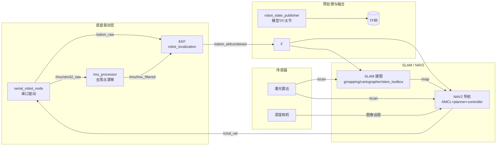
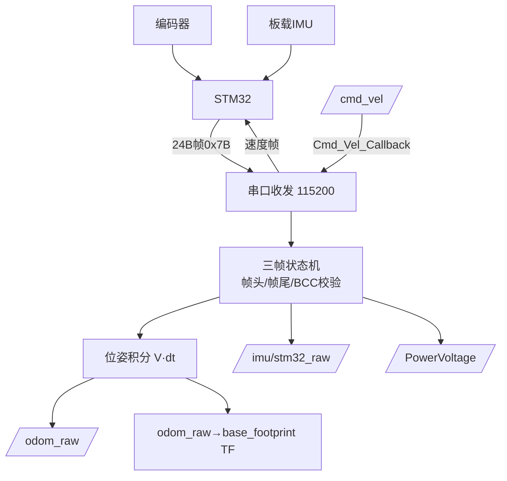
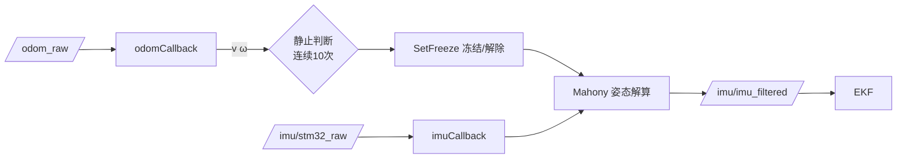
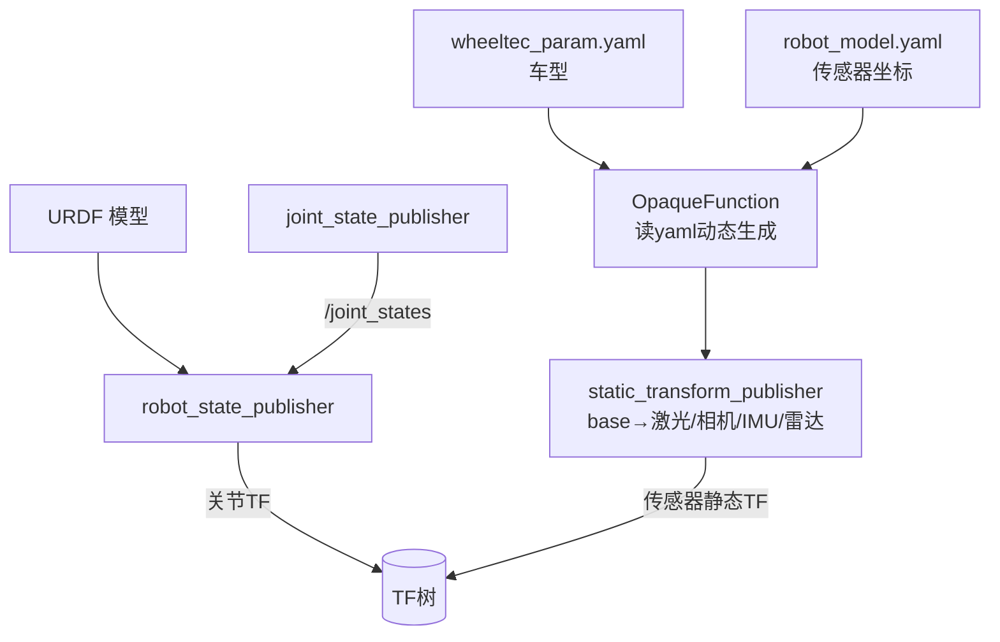
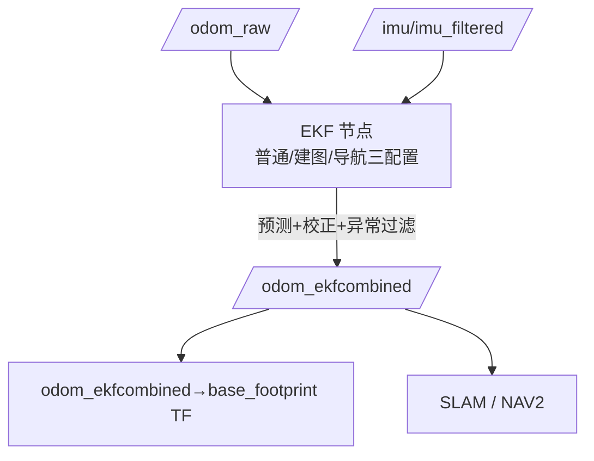
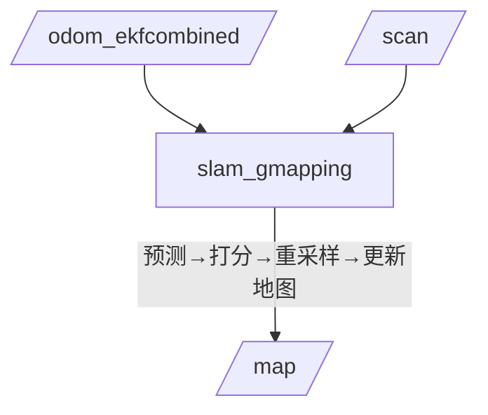
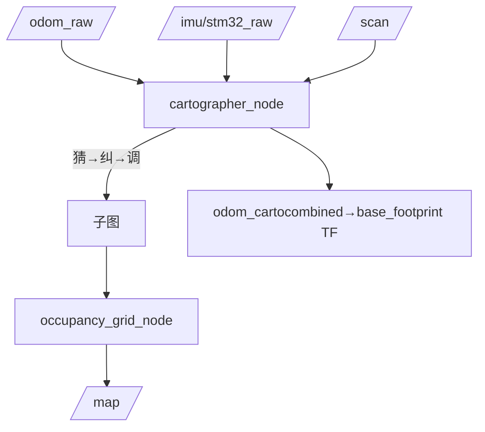
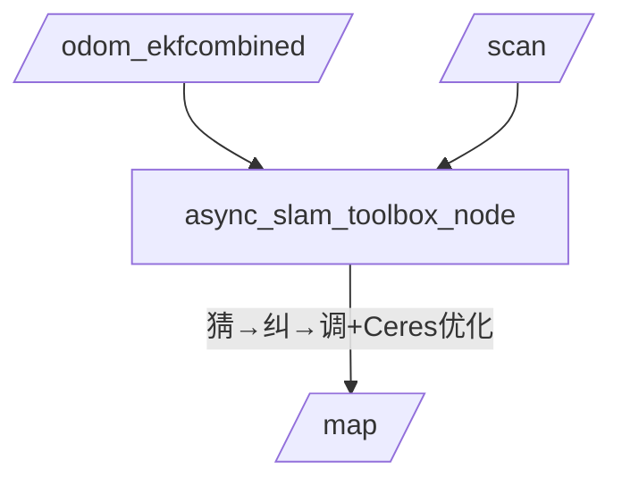
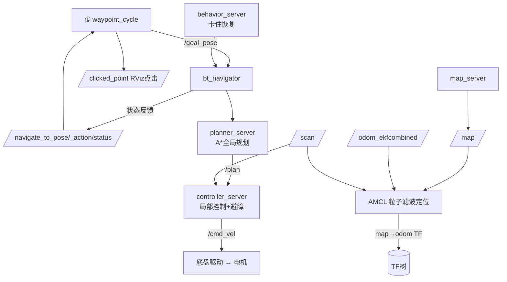
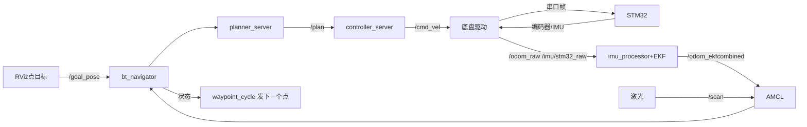

# 多点巡检机器人技术文档

> 基于 ROS2 Humble + Ubuntu 22.04，覆盖 **底盘驱动 → 传感器 → 位姿融合 → 建图 → 导航** 全链路，本文聚焦**多点巡检导航**实现。
>
> 架构：下位机（STM32，实时控制电机/采集传感器）通过串口与上位机（本 ROS2 系统）通信；上位机融合传感器数据做定位、建图、导航决策，再下发 `/cmd_vel` 控制底盘，形成闭环。

---

## 系统总体架构

**一句话**：底盘数据 → 串口 → 里程计/IMU 话题 → 去漂移/EKF 融合 → 建图/导航 → 下发 `/cmd_vel` 回底盘，闭环。

---

## 模块一：底盘串口驱动（base_serial.launch.py）

### 功能
启动底盘驱动主节点 `wheeltec_robot_node`，通过串口（`/dev/wheeltec_controller`，115200）与 STM32 通信：接收轮速/IMU/电压并发布话题，订阅 `/cmd_vel` 下发速度指令驱动电机。

### 方法
- **三帧状态机解析**（`Get_Sensor_Data_New`）：每次读 1 字节，靠"帧头/帧尾 + 长度 + BCC 异或校验"切分三种帧：

| 帧 | 帧头 | 帧尾 | 长度 | 内容 |
|----|------|------|------|------|
| 底盘数据帧 | 0x7B | 0x7D | 24B | 轮速 X/Y/Z、IMU六轴、电压 |
| 回充数据帧 | 0x7C | 0x7F | 8B | 充电电流、红外、状态 |
| 超声波帧 | 0xFA | 0xFC | 19B | 6路超声波距离 |

- **主循环** `Control()`：读串口 → 有完整帧则发布 Odom/IMU/电压 → `spin_some()` 非阻塞处理回调（避免阻塞串口读取）。
- **里程计积分**：差速运动学正解，$X_{t+1}=X_t+(Vx\cos\theta-Vy\sin\theta)\cdot dt$，速度 × 时间积分得位移，yaw 转四元数发布。

### 数据流图

---

## 模块二：IMU 去零点漂移（imu_processor.launch.py）

### 功能
把底盘原始 IMU（`/imu/stm32_raw`）修正**静止零点漂移**（陀螺仪静止时输出不为 0，积分会导致姿态缓慢漂移），输出干净 `/imu/imu_filtered` 供 EKF 使用。

### 方法
- **静止检测**：订阅 `/odom_raw`，当 |线速度|、|角速度| 均小于阈值，连续 10 次判静止 → `SetFreeze(true)`，否则解除。
- **冻结姿态解算**：静止时冻结角速度积分，防止零偏累积；运动时解除。
- **Mahony 互补滤波（AHRS）**：陀螺仪角速度积分得姿态四元数，将重力方向旋转后与加速度计测量比较，用叉积误差修正姿态。

### 数据流图

---

## 模块三：机器人模型与关节发布（robot_mode_description.launch.py）

### 功能
发布机器人模型与 TF，让上层知道"传感器装在哪"：`robot_state_publisher` 加载 URDF 发布关节 TF；`joint_state_publisher` 发布 `/joint_states`；`static_transform_publisher` 发布 `base_footprint → 各传感器`（激光/相机/IMU/雷达）静态 TF。

### 方法
- **OpaqueFunction + 读 yaml 动态生成**：运行时读 `wheeltec_param.yaml` 取车型，读 `robot_model.yaml` 取该车型传感器坐标，动态生成静态 TF 节点（不同车型安装位置不同）。
- **静态 TF vs 动态 TF**：传感器相对本体固定位置 → 静态 TF（/tf_static，一次）；本体相对世界实时位姿 → 动态 TF（/tf，高频，由里程计/EKF/AMCL 发布）。
- **关节 TF**：URDF 中 `fixed` 关节按 origin 静态发布；`continuous/revolute` 关节读 `/joint_states` 动态发布。

### 数据流图

---

## 模块四：EKF 里程计融合（wheeltec_ekf.launch.py）

### 功能
用 `robot_localization` 包的 **EKF** 融合轮式里程计 + IMU（按协方差加权），输出稳定位姿 `/odom_ekfcombined` 并发布 `odom_ekfcombined → base_footprint` TF。

### 方法
- **为何融合**：里程计短期准、长期漂移（打滑/磨损）；IMU 高频平滑但有零点漂移、积分发散。EKF 以"预测 + 校正"两步融合，协方差越小越可信（底盘静止用更小协方差，运动用较大协方差，让 EKF 多参考 IMU）。
- **三种配置**（launch 参数动态选）：

| 模式 | 参数 | 配置 | 特点 |
|------|------|------|------|
| 普通 | 默认 | ekf.yaml | 2D、10Hz |
| 建图 | carto_slam:=true | ekf_carto.yaml | **3D**、**30Hz**、差分关闭 |
| 导航 | robot_nav:=true | ekf_nav.yaml | 2D、10Hz |

> 建图模式 3D/30Hz/非差分：为 Cartographer 提供完整绝对位姿轨迹做扫描匹配基准。

- **融合内容**：odom 融合 x/y/yaw/vx/vy/vyaw；imu 融合 yaw/vyaw。
- **坐标系（REP-105）**：`map`（全局固定）→ `odom_ekfcombined`（连续里程计）→ `base_footprint`（机器人本体）。

### 数据流图

---

## 模块五：三种 SLAM 2D 建图方式

| 方式 | 包 | 核心算法 | 输入里程计 | 特点 |
|------|----|---------|-----------|------|
| gmapping | slam_gmapping | 粒子滤波 | EKF（/odom_ekfcombined） | 经典、小场景 |
| Cartographer | wheeltec_cartographer | 图优化+扫描匹配 | **原始**（/odom_raw）+原始IMU | 精度高、可回环 |
| slam_toolbox | wheeltec_slam_toolbox | 图优化（Ceres） | EKF（/odom_ekfcombined） | 轻量、可重定位 |

### 5.1 gmapping（slam_gmapping.launch.py）

**功能/方法**：粒子滤波。一簇粒子代表假想位姿：①预测（按里程计更新粒子位姿）→ ②打分（激光与地图匹配评分）→ ③重采样（高分复制、低分淘汰）→ ④用高分粒子位置把扫描贴进 `/map`。

### 5.2 Cartographer（cartographer.launch.py）

**功能/方法**："猜→纠→调"：①猜：用**原始**里程计+IMU 增量预测位姿 → ②纠：激光与子图相关扫描匹配（Ceres 精修）修正并贴图 → ③调：回环检测（min_score=0.65）后每 50 节点全局优化消除漂移。

> 吃原始 odom/IMU（自带数据处理更精确）；自己发布 `odom_cartocombined → base_footprint` TF（`provide_odom_frame=true`）。

### 5.3 slam_toolbox（online_async_launch.py）

**功能/方法**：与 Cartographer 相同的"猜→纠→调"图优化，但吃 **EKF 处理后的** `/odom_ekfcombined`，更轻量；`mode` 支持 mapping/localization 切换；async 异步模式（匹配与建图分线程）响应快。

---

## 模块六：NAV2 多点导航（wheeltec_nav2.launch.py）

### 功能
导航总入口，一次启动四组：①`waypoint_cycle` 多点巡航；②底盘驱动+去漂移IMU+EKF(导航配置)+模型TF；③激光雷达；④NAV2 官方 `bringup_launch.py`（AMCL定位+全局规划+局部控制+行为树）。

### 方法
- **定位**：`map_server` 加载地图发布 `/map`；**AMCL**（粒子滤波，原理同 gmapping）订阅 `/scan`+`/odom_ekfcombined` 定位，发布 `map→odom_ekfcombined` TF 修正漂移。
- **导航四子流程**：`bt_navigator`（行为树决策：规划→控制→卡住恢复重规划）→ `planner_server`（A* 全局路径 `/plan`）→ `controller_server`（局部控制+实时避障，发 `/cmd_vel`）→ `behavior_server`（卡住时恢复）。
- **多点巡航**（`waypoint_cycle`）：订阅 `/clicked_point`（RViz 点击）与 `navigate_to_pose/_action/status`（导航结果），发布 `/path_point`（可视化 MarkerArray）与 `/goal_pose`（目标）；成功→发下一个点，走完回绕循环，失败→重试 1 次再跳过。

### 数据流图

---

## 附录：一次完整导航数据流

**闭环**：底盘驱动 → 预处理/融合 → 建图/导航 → 速度回底盘。
