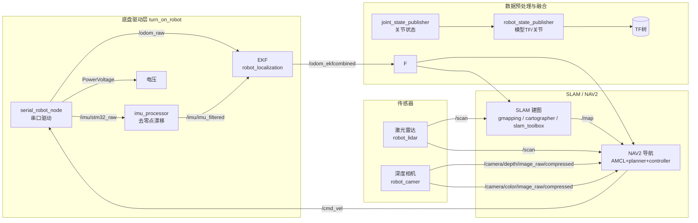
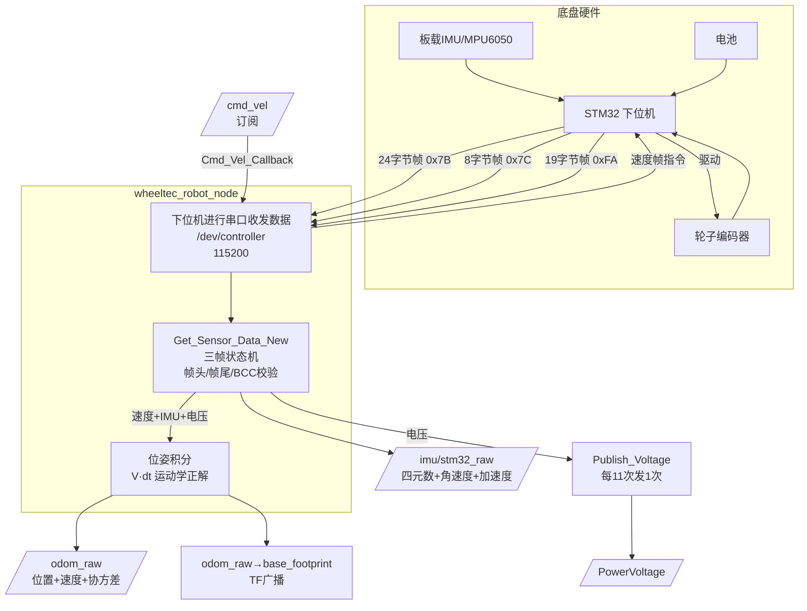
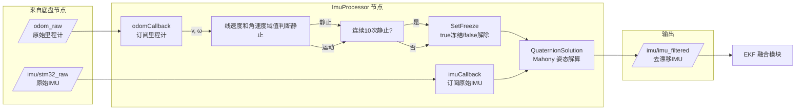
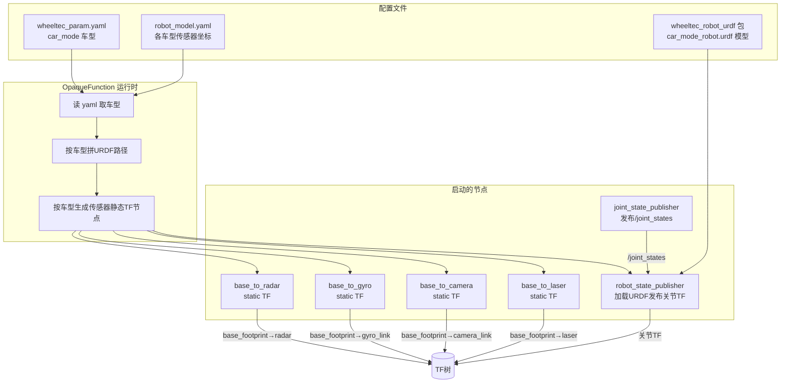
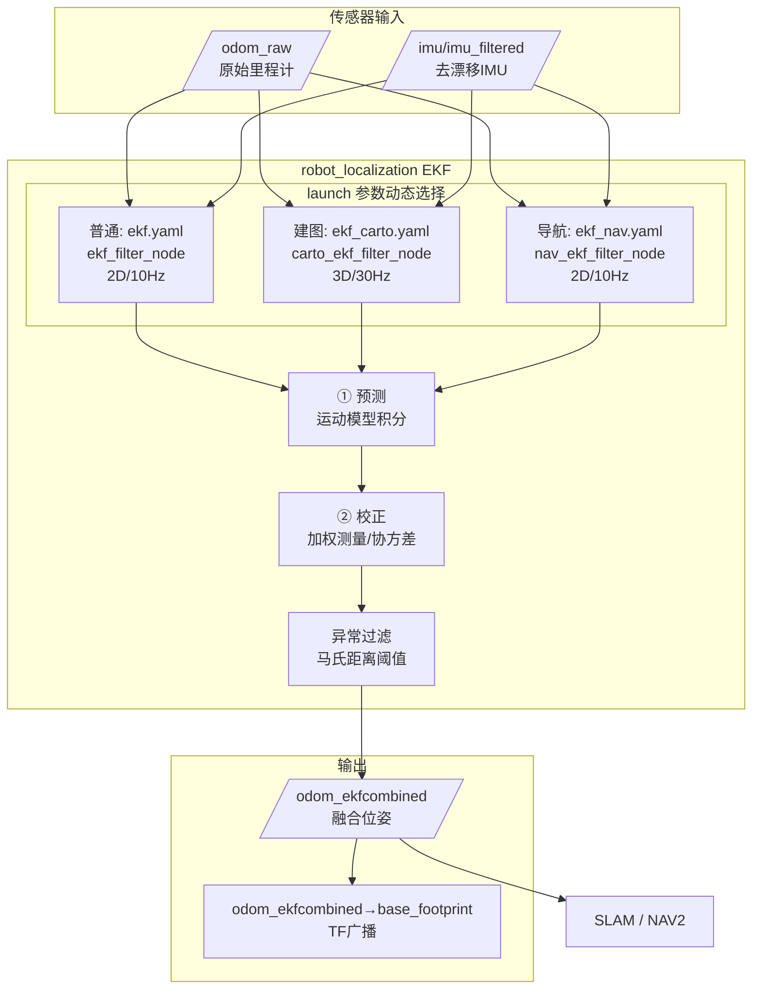
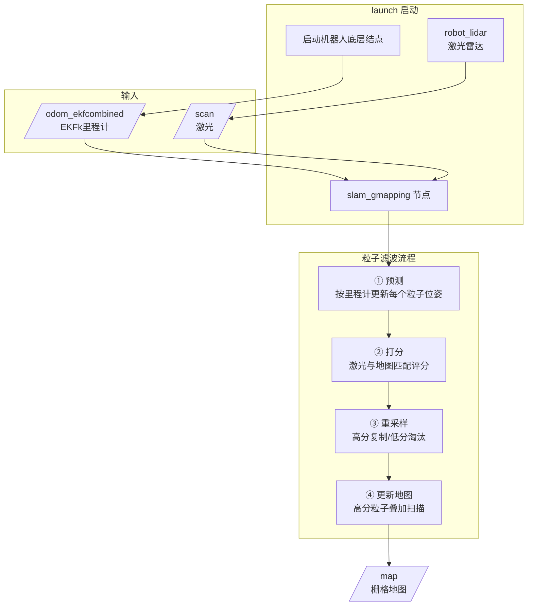
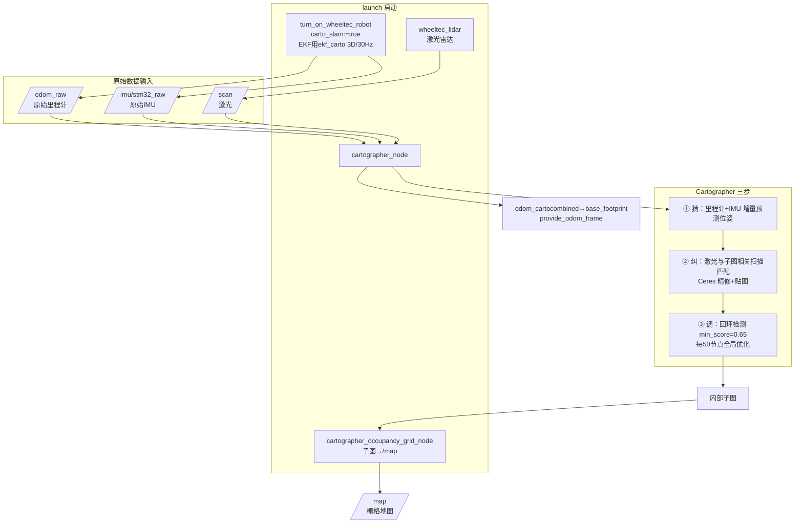
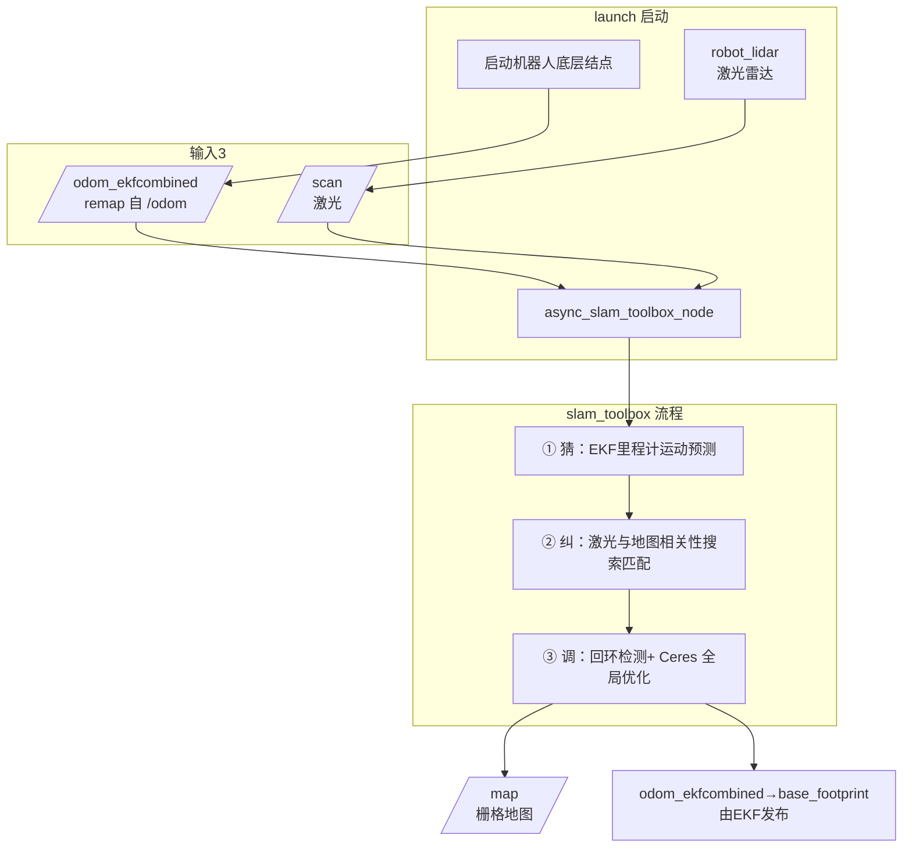
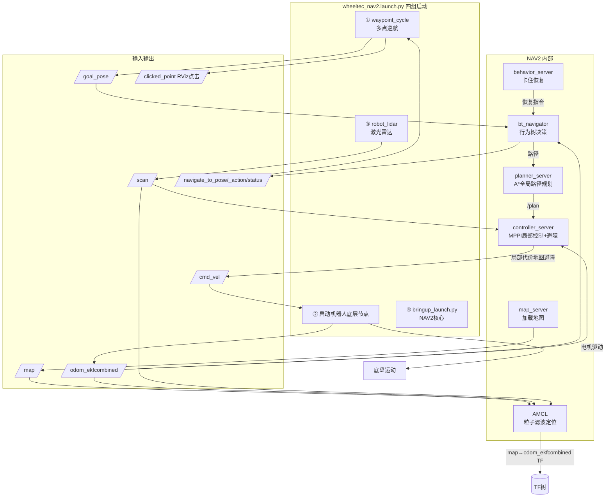
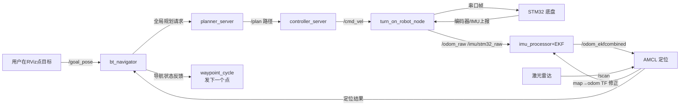

# 多点巡检机器人项目技术文档

> ​	一个完整的AI机器人应该至少包括上位机和下位机两个部分：下位机需要采用RTOS实时调度系统以确保可以实时控制机器人运动，也就是所谓的“小脑"。由于AI机器人需要自主感知环境，并且根据环境信息自动做出正确的运动决策，这就需要各种传感器包括：激光雷达、相机、超声波、GPS等用于获取周围环境信息，并结合AI算法进行计算，然后做出运动决策。下位机通常没有高算力，需要提供较高算力的上位机通过传感器获取周围环境信息，然后采用AI模型进行计算，计算后向下位机发出相应的控制指令，下位机接收到控制指令后，控制机器人运动，这也就是所谓的”大脑“。上位机和下位机的通信方式，包括常见的串口通信，CAN总线通信等，一般通过指定的帧格式实现大小脑间数据交换。
>
> ​	本文按模块讲解多点巡检机器人上位机的实现原理与数据流动过程，基于 ROS2 Humble + Ubuntu 22.04环境，覆盖 **底盘驱动 → 传感器 → 位姿融合 → 建图 → 导航** 全链路，**本文只涉及到多点巡检导航的实现过程**。

---

## 系统总体架构



**数据流一句话**：底盘(轮子/IMU/电压) → 串口 → 里程计+IMU 话题 → 去漂移/EKF 融合 → 建图/导航 → 又回到底盘执行 `/cmd_vel`，形成闭环。

---

## 模块一：底盘串口驱动（serial.launch.py）

### 1.1 模块功能

`base_serial.launch.py` 是**整个项目的起点**。它启动底盘驱动主节点 `wheeltec_robot_node`，负责：

- 通过**串口**（`/dev/wheeltec_controller`，波特率 115200）和底盘单片机（STM32）通信；
- **接收**下位机上报的：轮速、IMU 六轴原始数据、电池电压（可选：充电/超声波数据）；
- **发送**上位机的速度指令（`/cmd_vel`）给下位机，驱动电机；
- **发布** `/odom_raw`（原始里程计）、`/imu/stm32_raw`（原始 IMU）、`/PowerVoltage`（电压）等话题。

### 1.2 实现原理：三帧状态机串口解析

下位机以固定格式（帧头 + 数据 + 校验 + 帧尾）持续上报数据，共 **3 种帧**：

| 帧类型         | 帧头   | 帧尾   | 长度    | 内容                           |
| -------------- | ------ | ------ | ------- | ------------------------------ |
| 基础底盘数据帧 | `0x7B` | `0x7D` | 24 字节 | 轮速 X/Y/Z、IMU 六轴、电池电压 |
| 自动回充数据帧 | `0x7C` | `0x7F` | 8 字节  | 充电电流、红外信号、充电状态   |
| 超声波数据帧   | `0xFA` | `0xFC` | 19 字节 | 6 路超声波距离 A~F             |

核心函数 `Get_Sensor_Data_New()` 采用**单字节状态机**解析：

1. **每次调用只从串口读 1 字节**，存入三个接收数组；
2. 用三个计数器（`count/count2/count3`）分别"攒"三种帧；
3. 判断"上一字节是帧尾 && 当前字节是帧头" → 新帧开始，计数从 1 重数；
4. 攒够一帧长度后，先**校验帧尾**，再对前 N 字节做 **BCC 异或校验**，校验通过才解析数据；
5. 只有完整收到一帧底盘数据才返回 `true`，主循环据此决定是否发布话题。

**为什么这样设计？** 串口是字节流，没有明确的"消息边界"，必须靠帧头/帧尾 + 长度 + 校验来切分帧，并丢弃被干扰的脏数据，防止污染里程计。

### 1.3 主循环：读串口帧数据 + 发话题 + 处理回调

```
while(rclcpp::ok())
  ├─ ① Get_Sensor_Data_New()：读1字节，攒帧、解析
  ├─ ② 有完整一帧？→ Publish_Odom() + Publish_ImuSensor() + Publish_Voltage()
  ├─ ③ 有回充帧？→ Publish_Charging/RED/ChargingCurrent
  ├─ ④ 有超声波帧？→ Publish_distance()
  └─ ⑤ rclcpp::spin_some()：非阻塞处理 /cmd_vel 等订阅回调
```

**关键设计**：用 `spin_some()` 而不是 `spin()`——`spin()` 会阻塞在回调等待上，导致串口无人读取而丢数据；`spin_some()` 处理完已排队的回调立即返回，主循环能继续读串口，两不耽误。

### 1.4 IMU数据话题发布和Odom里程计数据话题发布

#### IMU数据话题发布(Publish_ImuSensor)

​	需要先将串口中接收到下位机上传的IMU数据的三轴角速度和三轴线速度进行ADC数值转换单位，然后需要计算姿态四元数。

1. IMU陀螺仪的 ADC 原始值 → 物理单位 rad/s 

   ​	与STM32初始化IMU的量程有关，这里陀螺仪量程 ±500°/s，因为机器人一般Z轴速度不快，降低ADC采集量程可以提高采集精度，GYROSCOPE_RATIO = 1/65.5/57.30 = 0.00026644（把±32768映射到±500°/s再转弧度rad/s）。

2. MU加速度计的 ADC 原始值 → 物理单位 m/s² 

   ​	与STM32初始化IMU时的量程有关，这里量程 ±2g = 19.6m/s²，ACCEl_RATIO = 32768/2g = 1671.84（把±32768映射到±19.6m/s²），在静止时 Z 轴不是 0，而是 ≈ +9.8（重力加速度），这是正常现象。

#### 里程计数据话题发布(Publish_Odom)

​	先进行运动学正解，然后进行里程计积分，计算相对于起点坐标系odom_raw的小车本体位置base_footprintf距离。里程计位置通过对速度做时间积分得到（差速小车运动学正解）：
$$
\begin{bmatrix} X' \\ Y' \end{bmatrix} = \begin{bmatrix} \cos\theta & -\sin\theta \\ \sin\theta & \cos\theta \end{bmatrix} \begin{bmatrix} Vx \\ Vy \end{bmatrix}
$$

$$
X_{t+1} = X_t + (Vx\cos\theta - Vy\sin\theta)\cdot dt, \quad
Y_{t+1} = Y_t + (Vx\sin\theta + Vy\cos\theta)\cdot dt, \quad
\theta_{t+1} = \theta_t + Vz\cdot dt
$$

​	其中 $dt$ = 两次循环的时间差（`Sampling_Time`），$\theta$ = 当前偏航角。发布前会乘以修正系数（`odom_x_scale` 等，修正编码器系统误差），并把 yaw 转成四元数。

### 1.5 数据流图



---

## 模块二：IMU 去零点漂移（imu_processor.launch.py）

### 2.1 模块功能

​	启动 `ImuProcessor_node`，把底盘发布的**原始 IMU**（`/imu/stm32_raw`）修正静止时的**零点漂移**问题，输出干净的 `/imu/imu_filtered`，供 EKF 在位姿融合时使用。

### 2.2 原理：为什么需要去零点漂移？

陀螺仪（角速度计）存在**静态零偏**——即使静止不动，输出也不为 0。如果直接对原始角速度积分求姿态角，静止时姿态会**缓慢漂移**（越积越偏），这样会造成一个现象机器人处于静止状态，但内部计算的机器人的偏航角会缓慢移动，导致实际方向和内部计算的方向出现误差。所以需要一个"静止检测 + 姿态解算冻结"策略。

### 2.3 实现：静止检测 + 姿态解算冻结

核心逻辑在 `ImuProcessor::imuCallback`：

```python
1. 订阅 /odom_raw 获取线速度 linear_vel_ 与角速度 angular_vel_
2. 若 |linear_vel_| < 阈值 且 |angular_vel_| < 阈值 → 静止计数 static_count++
   否则 → static_count = 0（说明在运动，不是静止）
3. 若 static_count >= 10（连续10次判静止）→ Quaternion_Solution.SetFreeze(true)
   否则 → SetFreeze(false)
4. Quaternion_Solution(out)：用 Mahony 互补滤波解算四元数姿态
5. 发布修正后的 IMU 到 /imu/imu_filtered
```

**冻结（freeze）的含义**：静止时把姿态解算的"角速度积分"冻结，让陀螺仪零偏不再累积进姿态角；同时用加速度计的重力方向来纠正姿态。运动时解除冻结，正常积分。

**姿态解算原理**：将IMU的原始xyz三轴线速度和三轴角速度计算姿态四元数，采用Mahony互补滤波（AHRS）算法融合底盘上传的IMU芯片的陀螺仪和加速度计分别测得的三轴角速度和三轴加速度计算姿态角。基本过程是利用陀螺仪测的三轴角速度及上次姿态四元数进行积分计算当前姿态四元数，然后将垂直重力加速度方向在该姿态四元数下旋转，比较旋转后的重力加速度是否和加速度计测的三轴加速度合并后的加速度一致，并根据两者向量叉积误差去修正当前姿态四元数。

### 2.4 数据流图



---

## 模块三：机器人模型与关节发布及TF变换（robot_mode_description.launch.py）

### 3.1 模块功能

启动机器人**模型描述 + 静态 TF**，让上层（RViz、导航、建图）知道"传感器装在机器人哪里"：

- `robot_state_publisher`：加载 URDF 模型，发布各连杆link间的joint关节关系的静态 TF 变换(Fixed属性joint)；
- `joint_state_publisher`：发布 `/joint_states` 关节状态话题（配合 URDF 显示连接link间的Continue关系的关节关系的动态 TF 变换）；
- 多个 `static_transform_publisher`：发布 `base_footprint → 各类传感器`（激光、相机、IMU、雷达）的**固定静态 TF 变换**。

### 3.2 实现原理

**关键设计：OpaqueFunction + 读 yaml 动态生成节点**，包括机器人状态发布结点和关节状态发布结点：

- 机器人状态发布结点：通过加载机器人模型的URDF文件进行发布。
- 关节状态发布节点：配合机器人状态发布节点，发布机器人模型中的URDF文件发布关节状态关系数据/joint_state。
- 发布机器人本体投影到各传感器的静态 TF 坐标变换发布(可选，因为保证URDF正确时，TF系统可以通过链式计算得到)。

**静态 TF vs 动态 TF 的区别**：

| 类型    | 发布者                                | 用途                     | 频率               |
| ------- | ------------------------------------- | ------------------------ | ------------------ |
| 静态 TF | `static_transform_publisher`          | 传感器相对本体的固定位置 | 一次（/tf_static） |
| 动态 TF | 里程计/EKF/AMCL/joint_state_publisher | 本体相对世界的实时位姿   | 高频（/tf）        |

**关节 TF**：`robot_state_publisher` 对 URDF 里的 `fixed` 关节直接按 `origin` 发布静态 TF；对 `continuous/revolute` 关节则读取 `joint_state_publisher` 的 `/joint_states`，结合关节 origin 动态发布。

**坐标系关系**（本项目的 TF 树核心）：

```
map → odom_ekfcombined（AMCL 或 EKF 发布）
  └→ base_footprint（EKF 发布）
       ├→ base_link（static，URDF）
       ├→ laser（static，机器人模型配置）
       ├→ camera_link（static）
       ├→ gyro_link（static）
       └→ radar（static）
```

### 3.3 数据流图



---

## 模块四：EKF 里程计融合（ekf.launch.py）

### 4.1 模块功能

启动 `robot_localization` 包的 **EKF 节点**，把 **轮式里程计 + IMU** 按可信度（协方差）加权融合，输出更稳定的融合位姿 `/odom_ekfcombined`，并发布 `odom_ekfcombined → base_footprint` 的 TF。

### 4.2 原理：为什么要融合？什么是 EKF？

**各自的优缺点**：

| 传感器           | 优点               | 缺点                      |
| ---------------- | ------------------ | ------------------------- |
| 轮式里程计 /odom | 短期准确、不会发散 | 打滑/磨损导致**长期漂移** |
| IMU              | 高频平滑、姿态准   | **零点漂移**、积分发散    |

**EKF（扩展卡尔曼滤波）** 把两者按"预测 + 校正"两步融合：
1. **预测**：采用里程计数据/IMU数据计算增量，用运动模型（速度积分）预测下一个位姿。
2. **校正**：用传感器测量数据（里程计数据/IMU数据）校正预测值，误差由**协方差矩阵**决定谁更可信。

> 协方差越小 = 数据越可信。底盘在发布 `/odom_raw` 时就提供了两套协方差：**静止时用更小的协方差**（编码器没转，误差小，让EKF 多参考 Odom数据），**运动时用较大的协方差**（可能打滑，让 EKF 多参考 IMU）。

### 4.3 三种配置（通过 launch 参数选择）

`wheeltec_ekf.launch.py` 根据 `carto_slam` / `robot_nav` 两个参数，动态启动不同节点与配置文件：

| 模式         | 触发参数           | 节点名                  | 配置文件         | 特点                                          |
| ------------ | ------------------ | ----------------------- | ---------------- | --------------------------------------------- |
| **普通模式** | 默认               | `ekf_filter_node`       | `ekf.yaml`       | 2D 模式，10Hz                                 |
| **建图模式** | `carto_slam:=true` | `carto_ekf_filter_node` | `ekf_carto.yaml` | **3D 模式**，30Hz，`odom0_differential:false` |
| **导航模式** | `robot_nav:=true`  | `nav_ekf_filter_node`   | `ekf_nav.yaml`   | 2D 模式，10Hz                                 |

三者都输出到 `/odom_ekfcombined`（remap 自 `/odometry/filtered`），都 `publish_tf: true`。

**三种配置的关键差异与原因**：

| 参数                 | 普通/导航           | 建图(carto)         | 原因                                                         |
| -------------------- | ------------------- | ------------------- | ------------------------------------------------------------ |
| `two_d_mode`         | true                | **false**           | 建图要完整 3D 位姿（含 z/roll/pitch），应对地面起伏；导航只需平面 |
| `frequency`          | 10Hz                | **30Hz**            | Cartographer 位姿插值需要细粒度时间戳，要高频率              |
| `sensor_timeout`     | 1.5s                | **0.1s**            | 建图对实时性敏感，过时数据立即丢弃                           |
| `odom0_differential` | true                | **false**           | 普通/导航用差分平滑抗漂移；建图需要**完整绝对轨迹**做扫描匹配基准 |
| `imu0`               | `/imu/imu_filtered` | `/imu/imu_filtered` | 都用去漂移后的 IMU                                           |
| `odom0`              | `/odom_raw`         | `/odom_raw`         | 都用原始里程计                                               |

**融合内容**（`odom0_config` / `imu0_config` 15 元素数组，顺序为 x,y,z,roll,pitch,yaw,vx,vy,vz,vroll,vpitch,vyaw,ax,ay,az）：
- odom 融合：x、y、yaw、vx、vy、vyaw（`true,true,false, false,false,true, true,true,false, false,false,true, ...`）
- imu 融合：yaw、vyaw（`false,false,false, false,false,true, ... false,false,true`）

**坐标系（REP-105 规范）**：
- `map_frame: map`：全局固定，可能跳变
- `odom_frame / world_frame: odom_ekfcombined`：连续、短期准、长期漂
- `base_link_frame: base_footprint`：随机器人动

### 4.4 数据流图



---

## 模块五：三种 SLAM 的2D建图方式

> SLAM（Simultaneous Localization And Mapping）= 机器人边移动边"定位自己 + 拼出地图"，这里介绍3种常见的2D的slam建图方式，根据需要可以使用3D的slam建图方式。

**三种方式对比**：

| 方式         | 包                      | 核心算法          | 输入里程计                    | 特点                        |
| ------------ | ----------------------- | ----------------- | ----------------------------- | --------------------------- |
| gmapping     | `slam_gmapping`         | 粒子滤波          | EKF（/odom_ekfcombined）      | 经典、老牌、适合小场景      |
| Cartographer | `wheeltec_cartographer` | 图优化 + 扫描匹配 | **原始**（/odom_raw）+原始IMU | Google 出品、精度高、可回环 |
| slam_toolbox | `wheeltec_slam_toolbox` | 图优化（Ceres）   | EKF（/odom_ekfcombined）      | 轻量、支持重定位模式        |

### 5.1 gmapping 建图（slam_gmapping.launch.py）

#### gmapping建图原理：粒子滤波

​	采用一定数量的粒子，每个粒子代表一个假想的机器人位姿，随着每次激光扫描收到一次激光/scan话题数据，进行以下过程淘汰不符合粒子并保留符合粒子：

1. 预测：计算每个粒子按照/odom_ekfcombined里程计数据进行计算位姿。
2. 打分：比对/scan激光扫描结果对每个粒子进行匹配打分。
3. 重采样：按照分数重新抽样，高分粒子被复制多份，低分粒子直接淘汰，粒子总数不变。
4. 用高分粒子的位置，叠加当前激光扫描结果贴进地图/map，进行更新地图。

#### **gmapping建图流程**：

1. 启动本launch文件，打开3个结点：ros2 launch slam_gmapping slam_gmapping.launch.py
   1. 启动小车底层（turn_on_wheeltec_robot.launch.py）→ 底盘驱动 + EKF + 模型/TF
   2. 启动激光雷达（wheeltec_lidar.launch.py）→ 提供 /scan 激光数据
   3. 启动 slam_gmapping 节点（核心建图）→ 融合 /scan + /odom_ekfcombined 建图，发布 /map
2. 遥控小车缓慢走遍周围环境。
3. 采用命令保存地图，ros2 run nav2_map_server map_saver_cli -f ~/map/my_map

#### 数据流图



### 5.2 Cartographer 建图（cartographer.launch.py）

#### Cartographer 建图原理：

​	Cartographer 使用**原始** odom 和 IMU（remap 到 `/odom_raw`、`/imu/stm32_raw`），因为它自带数据处理，配合激光扫描纠正更精确，"里程计+IMU预测 + 激光扫描匹配 + 回环检测优化" 三步，让机器人边走动边"定位自己 + 拼接环境地图"，最后输出一张完整地图：

1. **猜（预测）**：采用原始/odom_raw里程计数据+原始IMU数据/stm32_raw，通过增量进行**运动预测**机器人位置。
2. **纠（扫描匹配）**：在机器人预测位置获取激光雷达/scan话题数据，与已有子图进行**扫描匹配**，找到最吻合位置。进行修正预测位置，并把新扫描结果贴进子图。
3. **调（全局优化）**：在机器人扫描到曾经来过的位置时，进行**回环检测**确认，然后进行**全局优化**，调整所有相关子图位置，**消除累积漂移误差**。

#### cartographer建图流程：

1. 启动本launch文件ros2 launch wheeltec_cartographer cartographer.launch.py，打开 4 个结点：
   1. 启动小车底层（turn_on_robot.launch.py，传 carto_slam=true）→ 底盘驱动 + EKF（建图配置）+ 模型/TF
   2. 启动激光雷达（robot_lidar.launch.py）→ 提供 /scan 激光数据
   3. 启动 cartographer_node（核心建图节点）→ 融合 /scan + /odom + /imu，实时建图
   4. 启动 cartographer_occupancy_grid_node（地图栅格节点）→ 把 Cartographer 内部子图转成 ROS 标准 /map 地图话题
2. 控制小车运动，缓慢在房间内扫描周围环境进行建图。
3. 执行ros2 run nav2_map_server map_saver_cli -f ~/map/my_map命令，生成my_map.pgm格栅地图文件

**关键配置**（cartographer.lua）：
- `odom_frame = "odom_cartocombined"`、`provide_odom_frame = true`：Cartographer 自己发布 `odom_cartocombined → base_footprint` 的 TF；
- `use_odometry = true`、`use_imu_data = true`：用里程计+IMU 预测；
- `num_laser_scans = 1`：1 路 2D 激光；
- `submaps.num_range_data = 45`：45 帧激光生成一个子图；
- `use_online_correlative_scan_matching = true`：在线相关扫描匹配。

> **注意**：建图模式下 EKF 用 `ekf_carto.yaml`（3D、30Hz、`odom0_differential:false`），但 Cartographer **不用 EKF 的数据**，它吃原始数据。EKF 在此时的作用是**为 AMCL 提供完整位姿轨迹**（双 odom 架构：EKF→`odom_ekfcombined`，Cartographer→`odom_cartocombined`，两条独立的 TF 边指向 base_footprint）。

#### 数据流图



### 5.3 slam_toolbox 建图（online_async_launch.py）

#### slam_toolbox 建图原理：

​	与cartographer建图原理完全相同，不同在于slam_toobox需要处理好的odom数据/odom_ekfcombined，并且更轻量。

1. 猜：采用EKF融合后的/odom_ekfcombined里程计数据，通过运动预测机器人位置。
2. 纠：在机器人预测位置获取激光雷达/scan话题数据，与已有地图进行扫描匹配（相关性搜索），找到最吻合位置，修正预测位置，并把新扫描结果贴进地图。
3. 调：在机器人扫描到曾经来过的位置时，进行回环检测确认，然后进行全局图优化（Ceres），调整所有相关节点位置，消除累积漂移误差。

slam_toolbox 建图原理与 Cartographer 相同（猜→纠→调），区别在于：
- **输入里程计**：用 **EKF 处理好的** `/odom_ekfcombined`（remap 自默认 `/odom`）；
- **更轻量**：实现更简单；
- **支持模式切换**：`mode: mapping`（建图）/ `localization`（重定位，可加载已有地图）；
- **异步（async）**：扫描匹配和建图分线程，响应快（本文件用的是 async 模式）。

关键配置（`mapper_params_online_async.yaml`）：Ceres 求解器、`do_loop_closing: true` 开回环、`resolution: 0.05`（5cm/格）、`map_update_interval: 5.0`（5 秒更新一次地图）。

####  slam_toolbox建图流程：

1. 启动launch文件，会启动3个结点，ros2 launch wheeltec_slam_toolbox online_async_launch.py：
   1. 启动小车底层（turn_on_wheeltec_robot.launch.py）→ 底盘驱动 + EKF + 模型/TF
   2. 启动激光雷达（wheeltec_lidar.launch.py）→ 提供 /scan 激光数据
   3. 启动 async_slam_toolbox_node（核心建图）→ 融合 /scan + /odom_ekfcombined 建图，发布 /map
2. 控制机器人缓慢运动进行边定位边建图。
3. 采用命令保存地图，ros2 run nav2_map_server map_saver_cli -f ~/map/my_map

#### 数据流图



---

## 模块六：NAV2 多点导航（nav2.launch.py）

### 6.1 模块功能

`nav2.launch.py` 是**导航总入口**，一次启动四组功能：

| 序号 | 启动内容                                     | 作用                                           |
| ---- | -------------------------------------------- | ---------------------------------------------- |
| ①    | `waypoint_cycle` 节点                        | 多点巡航：RViz 点多个航点，按序循环巡逻        |
| ②    | `turn_on_robot.launch.py`（robot_nav:=true） | 底盘驱动 + 去漂移 IMU + EKF(导航配置) + 模型TF |
| ③    | `robot_lidar.launch.py`                      | 激光雷达提供 `/scan`                           |
| ④    | NAV2 官方 `bringup_launch.py`                | AMCL 定位 + 全局规划 + 局部控制 + 行为树       |

### 6.3 导航启动流程

​	nav2导航启动命令ros2 launch wheeltec_robot_nav2 wheeltec_nav2.launch.py map:=~/map/my_map.yaml，启动后会打开以下4个结点文件：

1. 启动 waypoint_cycle（多点巡航节点）：在 RViz 里点多个目标点（航点），它就按顺序发布导航目标，让小车自动走完所有点并循环（巡检/巡航用）。
   1. 接收RViz的/clicked_pose话题在map上点击的导航目标，并通过/path_pose话题在map上发布可视化的导航目标点序号和路径，RViz通过订阅该话题在map上可视化显示。
   2. 通过订阅bt_navigator导航目标完成状态的/navigate_to_pose/_action/status话题，来获取上个导航目标点的完成状态。
      - 在成功时：执行到指定目标导航点的业务逻辑，包括采用相机传感器进行拍照等。然后通过/goal_pose话题向bt_navigator发布下一个导航目标，当终点导航目标被执行后，回到起点导航目标。
      - 在失败时：尝试再次重复进行导航，再次导航失败时，通过/goal_pose话题向bt_navigator发布下一个导航目标，当终点导航目标被执行后，回到起点导航目标。
2. 启动小车底层（turn_on_robot.launch.py）→ 底盘驱动结点 + EKF结点+ 模型/TF
   - 底盘驱动结点（wheeltec_robot_node）：发布：/odom_raw（原始里程计）、/imu/stm32_raw（原始IMU）、订阅：/cmd_vel（速度指令）
   - 去零点漂移结点（imu_processor）：订阅：/imu/stm32_raw，发布：/imu/imu_filtered（去漂移IMU）
   - EKF 位姿融合结点（ekf_filter_node，用 ekf_nav.yaml）：订阅：/odom_raw + /imu/imu_filtered、发布：/odom_ekfcombined（融合位姿）+ odom_ekfcombined→base TF
   - 模型/TF 结点（robot_state_publisher + joint_state_publisher + static_transform）
3. 启动激光雷达（wheeltec_lidar.launch.py）→ 提供 /scan 激光数据
4. 启动 NAV2 核心（nav2官方的bringup_launch.py）→ AMCL 定位 + 全局规划 + 局部控制 + 行为树
   - bringup_launch.py会启动localization_launch.py定位模块、navigation_launch.py导航模块、根据需要可以配置启动slam_launch.py建图模块。
   - localization_launch.py定位模块：map_server进行加载地图yaml文件，并发布/map话题
   - AMCL进行定位所在地图位置，并去除里程计漂移误差，发布map->odom的TF变换
   - navigation_launch.py导航模块：bt_navigator订阅/goal_pose话题获取导航目标，并根据导航行为树决策下步导航动作，先进行全局规划、控制机器人运动、卡住进行恢复并重新规划
   - planner_server进行全局路径规划，根据A*算法规划一条当前位置到目标点的无障碍物路径，并发布到/plan话题中
   - controller_server进行局部控制机器人按照全局路径运动，发布/cmd_vel话题数据
   - behavior_server实现出现运动卡住等异常时进行恢复

### 6.3 nav2导航基本过程原理：

**第 1 步：加载地图 + 定位**

1. map_server 加载地图 yaml 文件 → 发布 /map 话题（栅格地图）
2. AMCL 订阅 /scan（激光）+ /odom_ekfcombined（EKF里程计），用类似gmapping建图的粒子滤波算法，通过采用大量粒子结合/odom_ekfcombined里程计数据进行预测机器人位置，并结合/scan数据匹配，增加匹配度高的粒子数量，淘汰匹配度低的粒子，最后粒子进行收敛确定机器人所在位置，并根据激光数据匹配在 map 中定位机器人位置。发布 map→odom_ekfcombined 的 TF 变换。这个过程在导航过程会持续进行，每次接收/scan数据时进行，一边进行定位map位置，并修正里程计漂移误差。

**第 2 步：RViz 点击目标 → 开始导航**

用户在 RViz 点"2D Nav Goal" → 发布目标到 /goal_pose 话题，之后按以下 4 个子流程执行：

1. bt_navigator：行为树决策（导航大脑）：bt_navigator 会接收到 /goal_pose话题数据的导航目标，然后开始进行导航。根据 XML 行为树决定下一步动作："先全局规划 → 再控制运动 → 卡住了就恢复并重新规划"。
2. planner_server：全局路径规划（地图师）：用 A* 算法结合全局代价地图，从当前定位位置到目标点规划一条【无障碍】路径 → 发布到 /plan 话题（全局路径）。
3. controller_server：局部控制（司机）：结合 /scan 数据和局部代价地图（实时避障）和/odom_ekfcombined数据确定位置，控制机器人沿全局路径/plan运动 → 发布 /cmd_vel 速度指令→ 底盘驱动收到 /cmd_vel → 下位机 → 电机转动。
4.  behavior_server：恢复（救援队）：当机器人运动卡住 / 规划失败时，执行恢复动作（旋转、清除代价地图等）→ 然后 bt_navigator 重新规划。

### 6.4 waypoint_cycle 多点巡航原理

`waypoint_cycle` 节点（`nav2_waypoint_cycle` 包）实现**无限循环巡逻**，在 RViz 里点多个目标点（航点），它就按顺序发布导航目标，让小车自动走完所有点并循环（巡检/巡航用）。

1. 接收RViz的/clicked_pose话题在map上点击的导航目标，并通过/path_pose话题在map上发布可视化的导航目标点序号和路径，RViz通过订阅该话题在map上可视化显示。
2. 通过订阅bt_navigator导航目标完成状态的/navigate_to_pose/_action/status话题，来获取上个导航目标点的完成状态。在成功时：执行到指定目标导航点的业务逻辑，包括采用相机传感器进行拍照等。然后通过/goal_pose话题向bt_navigator发布下一个导航目标，当终点导航目标被执行后，回到起点导航目标。在失败时：尝试再次重复进行导航，再次导航失败时，通过/goal_pose话题向bt_navigator发布下一个导航目标，当终点导航目标被执行后，回到起点导航目标。

**导航闭环**：`waypoint_cycle` 发 `/goal_pose` → bt_navigator → 内部转成 NavigateToPose action → 规划/控制 → 底盘 → 完成后 status 话题反馈 → waypoint_cycle 发下一个点。

### 6.4 数据流图



---

#### 附录：数据流总览（一次完整导航）



**闭环要点**：底层驱动（模块1）→ 数据预处理（模块2/3/4）→ 建图/导航（模块5/6）→ 输出速度回到底盘，形成完整控制系统。